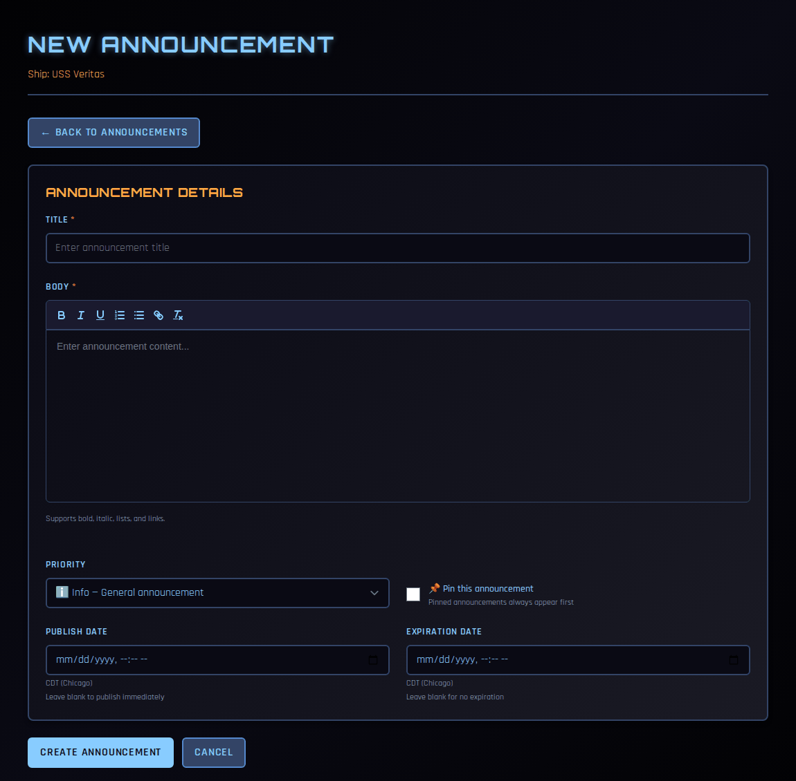
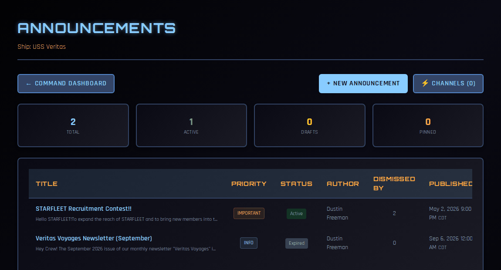
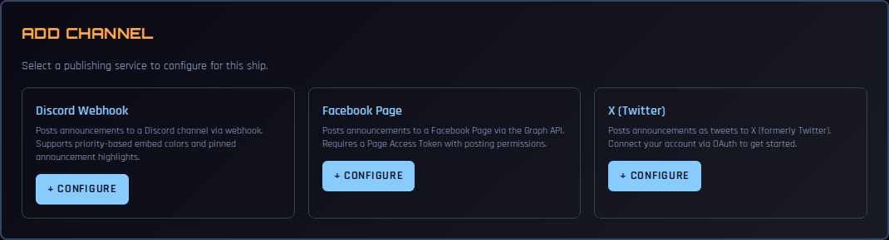

# Announcements and Social Posting

Announcements are how your command team tells the crew something everyone should see — a meeting change, a contest, the monthly newsletter. An announcement appears on every crew member's dashboard. It can also be posted automatically to your chapter's **Discord**, **Facebook Page** and **X** account at the same moment.

!!! note "About the screenshots"
    The screenshots on this page come from a test copy of COMPASS.

---

## Who can do what

| Task | Who |
|---|---|
| Post, edit and delete ship announcements | CO, XO |
| Set up Discord, Facebook and X channels | CO, XO, OPS, SO |
| Read announcements | All crew |

---

## Posting an announcement

1. On the **Command Dashboard**, find **Ship Announcements** and click **+ New**. (Or click **Manage**, then **+ New Announcement**.)
2. Fill in the form.

    

    - **Title** and **Body** — the body supports bold, italic, underline, lists and links.
    - **Priority** — **Info** for general news, **Important** for things that need attention, **Urgent** for immediate action. Priority sets the badge colour and how the post looks on Discord and X.
    - **Pin this announcement** — pinned announcements always appear first.
    - **Publish Date** — leave blank to publish now, or pick a future date and time.
    - **Expiration Date** — leave blank to keep it up until you remove it, or pick a date for it to disappear.
    - **Cross-Post to External Channels** — tick each channel to post to. This section only appears once you've [set up a channel](#setting-up-channels).

3. Click **Create Announcement**.

!!! warning "Scheduled announcements aren't cross-posted automatically"
    Cross-posting happens when you click **Create Announcement**, and only if the announcement is live at that moment. An announcement with a future **Publish Date** appears on dashboards when its date arrives, but it is **not** sent to Discord, Facebook or X on its own. When it goes live, open **Announcements** and use **Publish** on that row to send it to your channels.

---

## Managing announcements

Click **Manage** under Ship Announcements on the Command Dashboard.

The totals across the top count all, **Active**, **Drafts** (scheduled for the future) and **Pinned** announcements. For each announcement you can see its priority, status (Active, Draft or Expired), author, how many crew have dismissed it, and when it was published and expires.

- ✏️ **Edit** — change the text, priority, pin, or dates.
- 🗑️ **Delete** — removes it from COMPASS. Posts already on Discord, Facebook or X are not removed; delete those on each platform.
- **Publish** — send an announcement to one or more channels after the fact.

### How crew see announcements

Active announcements appear in the **Announcements** card on every crew member's dashboard, pinned ones first. A crew member can dismiss an announcement to hide it from their own dashboard; the **Dismissed By** column counts how many have.

---

## Setting up channels

Channels connect COMPASS to the places your crew already are. Go to **Announcements → ⚡ Channels**.

Under **Add Channel** you'll see the services you can connect. You can set up several of each — for example, two Discord channels.

!!! note
    On compass.sfi.org, Facebook and X show a **Connect with…** button that signs you in directly, plus a **Manual Setup** option. The screenshot above, from a test copy, shows **Configure** for all three.

### Discord

Discord channels use a **webhook** — a private address Discord gives you for posting into one channel.

1. In Discord, open the channel you want announcements in, and click the ⚙️ next to its name.
2. Go to **Integrations → Webhooks → New Webhook**.
3. Name it (for example, "COMPASS Announcements") and click **Copy Webhook URL**.
4. In COMPASS, click **Configure** on **Discord Webhook**.
5. Give the channel a display name and paste the **Webhook URL**.
6. Optionally set a **Bot Display Name**, and a **Mention Role ID for Urgent Alerts** — that role is pinged whenever you post an **Urgent** announcement.
7. Click **Save Channel**.

Discord posts use the announcement's priority for the embed colour, and highlight pinned announcements.

### Facebook Page

You must be an admin of the Facebook Page.

1. Click **Connect with Facebook** and sign in to Facebook.
2. Approve COMPASS.
3. Choose the **Page** to post to from the list of Pages you manage.
4. Check the **Display Name** and save.

Facebook posts include the announcement's title and text. In the channel's settings you can set **Include COMPASS Link** to add a link at the end of each post.

!!! warning "Facebook authorization lapses after about 90 days"
    Facebook stops letting COMPASS post roughly 90 days after you connect, and nothing can renew it automatically. COMPASS checks every day and reminds your officers **30, 15, 7 and 1 day** before the deadline. The channel shows **Expires in …**, then **Reconnect needed** once it has lapsed.

    To renew, someone with a role on the Facebook Page clicks **Connect with Facebook** again on the Channels page.

### X (Twitter)

1. Click **Connect with X**.
2. You're taken to X. **The account you're signed in to on X is the one that gets connected**, so check that first.
3. Approve COMPASS. You're returned to COMPASS, and the channel is set up — there are no keys to copy.

Posts on X are limited to 280 characters. COMPASS posts the title, as much of the body as fits (ending in "…" if it's cut short), and your ship's name. **Urgent** announcements start with 🔴 URGENT and **Important** ones with 🟠.

---

## Looking after your channels

The **Configured Channels** list shows each channel's status and how many posts it has made.

- 🔗 **Test Connection** — checks that COMPASS can still reach the service.
- ✏️ **Edit** — rename it, change its settings, or switch **Channel Active** off to pause posting without losing the setup.
- 🗑️ **Delete** — removes the channel from COMPASS.

A channel can be **Active** and still unable to post if its authorization has lapsed. Watch for **Reconnect needed** or **Check failed** next to the status.

---

## Common Questions

**I posted an announcement but it didn't appear on Facebook.**
Check the channel on the Channels page. **Reconnect needed** means Facebook's authorization lapsed; reconnect it, then use **Publish** on the announcement to send it again.

**I scheduled an announcement and it never reached Discord.**
That's expected — see [the warning above](#posting-an-announcement). Use **Publish** once it's live.

**Can crew members reply or comment?**
Not in COMPASS. Replies and reactions happen on Discord, Facebook or X.

**Do regional announcements work the same way?**
Yes. Your Regional Coordinator posts region-wide announcements from the Regional Dashboard, and they appear on every crew member's dashboard in the region.
