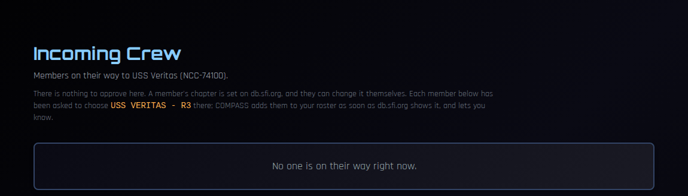

# Crew Transfers

Members move between chapters in COMPASS by following db.sfi.org, the official STARFLEET member database. **There is nothing for a CO to approve.** This page explains what you see when crew arrive or leave, and who to ask when a move needs a hand.

!!! note "About the screenshots"
    The screenshots on this page come from a test copy of COMPASS.

---

## How transfers work now

A member's chapter is set on **db.sfi.org**, and under SFI policy they can change it at any time, for any reason. COMPASS follows db.sfi.org rather than making its own decision:

1. The member chooses a new ship in COMPASS (or leaves without one).
2. COMPASS shows them exactly what to change on db.sfi.org.
3. Once db.sfi.org shows the change, COMPASS completes the move — straight away if the member clicks **check now**, otherwise overnight.

Until db.sfi.org changes, the member stays where they are. The member's side of this is described in [Joining or Changing Ships](../crew/changing-ships.md).

!!! info "Older guidance"
    Earlier versions of COMPASS had receiving COs confirm transfers, and RCs approve moves between regions. That approval step no longer exists.

---

## Crew on their way to you

When someone picks your ship, your command team is told they're on their way, and **Incoming Crew** appears in your left navigation with a count.

The page lists each member heading your way: their name and SCC, their rank, the ship they're coming from, when they started, and **Waiting for db.sfi.org**. It also shows the exact chapter name they've been asked to choose on db.sfi.org, which is useful if they ask you for help.

Below that, **Recent** shows the members who have arrived (or cancelled) and how each move was completed — for example, **Confirmed by *your ship* roster import**.

You don't need to do anything. When db.sfi.org shows the change, COMPASS adds them to your roster and lets you know. If someone seems stuck, the usual cause is that they haven't changed their chapter on db.sfi.org yet; point them to the steps on their request page.

The **Incoming Crew** link only appears while someone is on their way. You (the CO and XO) see it.

---

## Crew leaving your ship

A member leaves from **Leave Ship** on their record or Profile, choosing another COMPASS ship, becoming unassigned, or a chapter that isn't on COMPASS. Their assignment on your ship closes once db.sfi.org shows the change. Any positions, department assignments and ship roles they held on your ship end at the same time.

Their history — service, awards, points, rank — goes with them.

---

## Seeing a member's moves

Open a member's crew record and click **Transfer History** to see every move they've requested or made.

---

## Direct transfers

A **Direct Transfer** moves a member to a ship immediately, without waiting for db.sfi.org. It's an administrative tool for regional staff (the RC, VRC, RCOS and RCOO), used for things like a decommissioned chapter or regional rebalancing. COs and XOs don't have it.

If a member's move needs to happen right away, ask your Regional Coordinator.

---

## Common Questions

**A new member appeared on our roster without going through Incoming Crew.**
That's normal. Members also arrive through your roster import, which picks up anyone db.sfi.org lists on your chapter.

**Someone says they've changed their chapter but they're still on their old ship in COMPASS.**
Ask them to open their request and click **I've changed it — check now**. If db.sfi.org shows the change, the move completes immediately. Otherwise COMPASS checks overnight.

**Can I stop someone transferring to my ship?**
No. A member's chapter is their choice under SFI policy.
