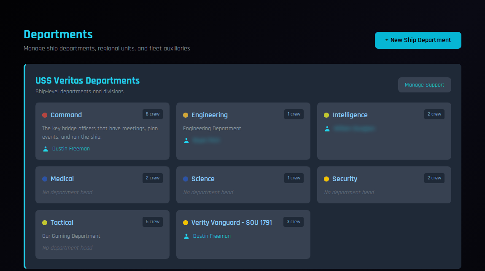
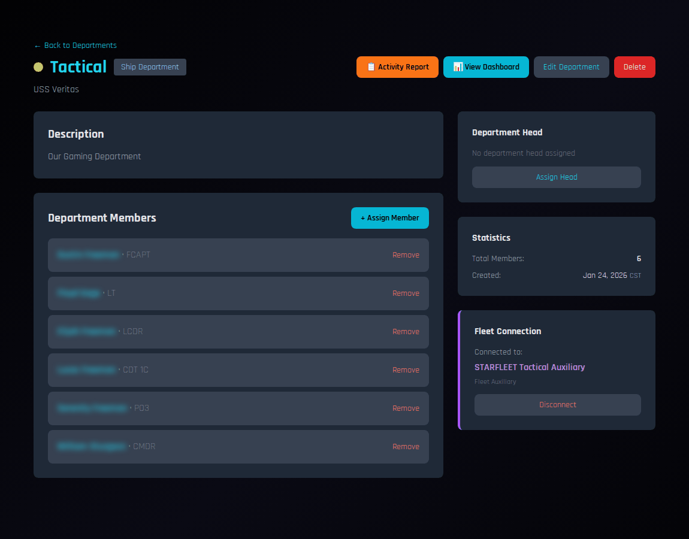
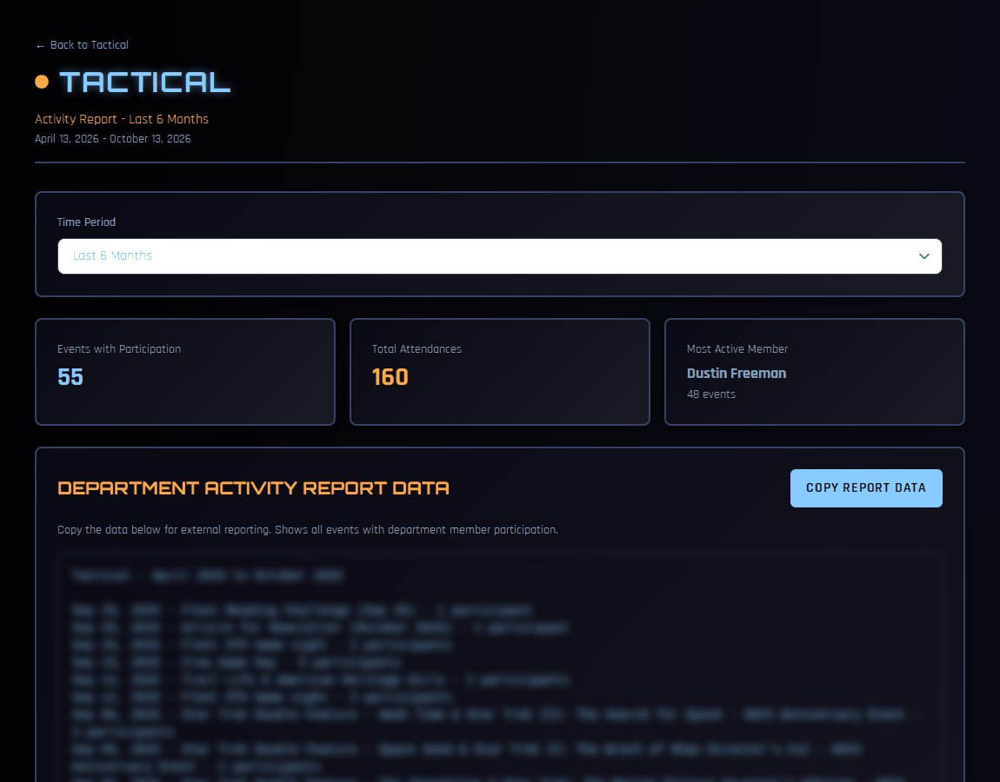

# Departments

Departments let you organise your crew the way your chapter actually runs: Command, Engineering, Medical, a gaming group, an away team, whatever fits. Each department has members, an optional department head, and its own activity report.

!!! note "About the screenshots"
    The screenshots on this page come from a test copy of COMPASS. Member names are blurred.

---

## Who can do what

| Task | Who |
|---|---|
| Create, edit or delete departments | CO, XO |
| Set the department head | CO, XO |
| Assign or remove members | CO, XO, SO, and department heads |
| Approve requests to join | CO, XO, SO, and the department's head |
| See a department's activity report | CO, XO, and that department's head |
| Request to join a department | Any crew member |

---

## Your departments

Go to **Departments** in the left navigation.

Each card shows the department's colour, how many crew are in it, its description, and its head. Click a card to open the department.

If you also hold a regional or fleet role, sections for regional departments and fleet auxiliaries appear below your ship's.

---

## Creating a department

1. On the Departments page, click **+ New Ship Department**.
2. Enter a **name** and an optional **description**, and pick a **colour**.
3. Save.

To change these later, open the department and click **Edit Department**. **Delete** removes the department; its members aren't affected in any other way.

---

## Managing a department

Open a department to see its page.

### Members

1. Click **+ Assign Member**.
2. Choose a crew member.
3. Optionally give them a **Role/Position** within the department, such as "Chief Engineer" or "Assistant".
4. Tick **Set as primary department** if this is their main department. A member can belong to several departments, but only one is primary.
5. Click **Assign**.

Click **Remove** next to a member to take them out of the department.

### Department head

Under **Department Head**, click **Assign Head** and choose a member. The head can approve join requests and see the department's activity report.

### Fleet connection

Many STARFLEET fleet-level auxiliaries — such as the STARFLEET Tactical Auxiliary — have a matching fleet department in COMPASS. Click **Connect to Fleet** to link your ship's department to it.

Connecting lets the fleet department see your department as part of its network. It doesn't move or share any members. **Disconnect** removes the link at any time.

---

## Department dashboard

Click **View Dashboard** on a department page for an at-a-glance view:

- Total members, with primary and secondary assignments
- The department head
- **Recent Assignments** and **Recent Departures** in the last 30 days
- If connected to a fleet department: network members, linked ships, and supporting ships across the whole network

---

## Activity report

Click **Activity Report** on a department page to see what the department's members have been doing.

1. Choose a **Time Period**: the last 1, 2, 3 or 6 months. The default is 2 months.
2. Read the summary: events with department participation, total attendances, and the most active member.
3. Scroll down for each member's events attended, points earned and participation rate, and for a list of every event with which department members attended.

**Copy Report Data** and **Copy Roster Data** copy the report and the department roster as plain text, ready to paste into a fleet auxiliary report or an email. The roster includes each member's rank, SCC and membership expiration.

!!! tip
    Fleet auxiliaries often ask for a periodic report. Run the activity report for the period they ask about and paste the copied text into their form.

---

## Requests to join

Crew members who open a department they don't belong to see a **Request to Join** button, with an optional message.

Pending requests appear in the **Notifications** panel on the Crew Dashboard of everyone who can approve them — the CO, XO and SO for any department, and each department head for their own. The notice links to the department, where you **Approve** or **Deny** the request.

No email or push notice is sent for join requests, so check your dashboard. The member sees **Request Pending** on the department page until you decide.

---

## Departments elsewhere in COMPASS

- The **Command Dashboard** shows a **Crew by Department** chart, including how many crew aren't in any department yet.
- Each member's departments appear on their **crew record** and their dashboard.
