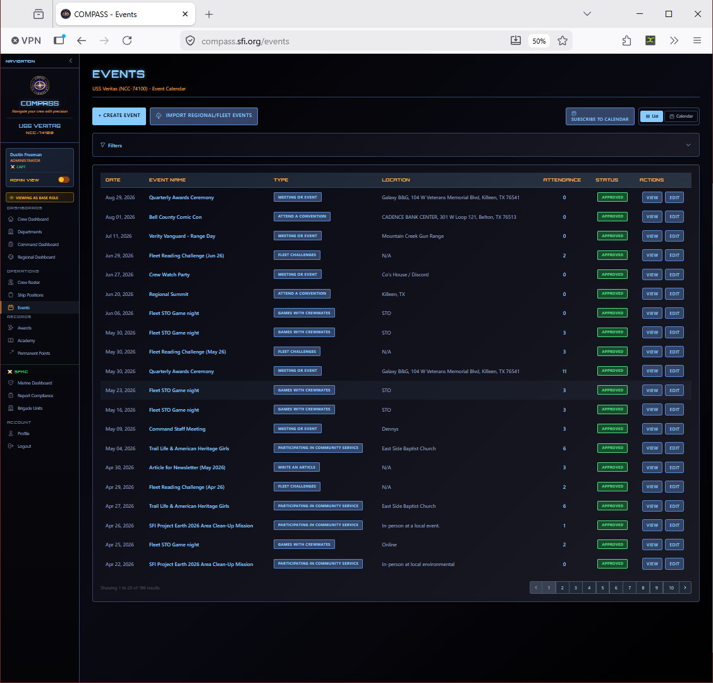
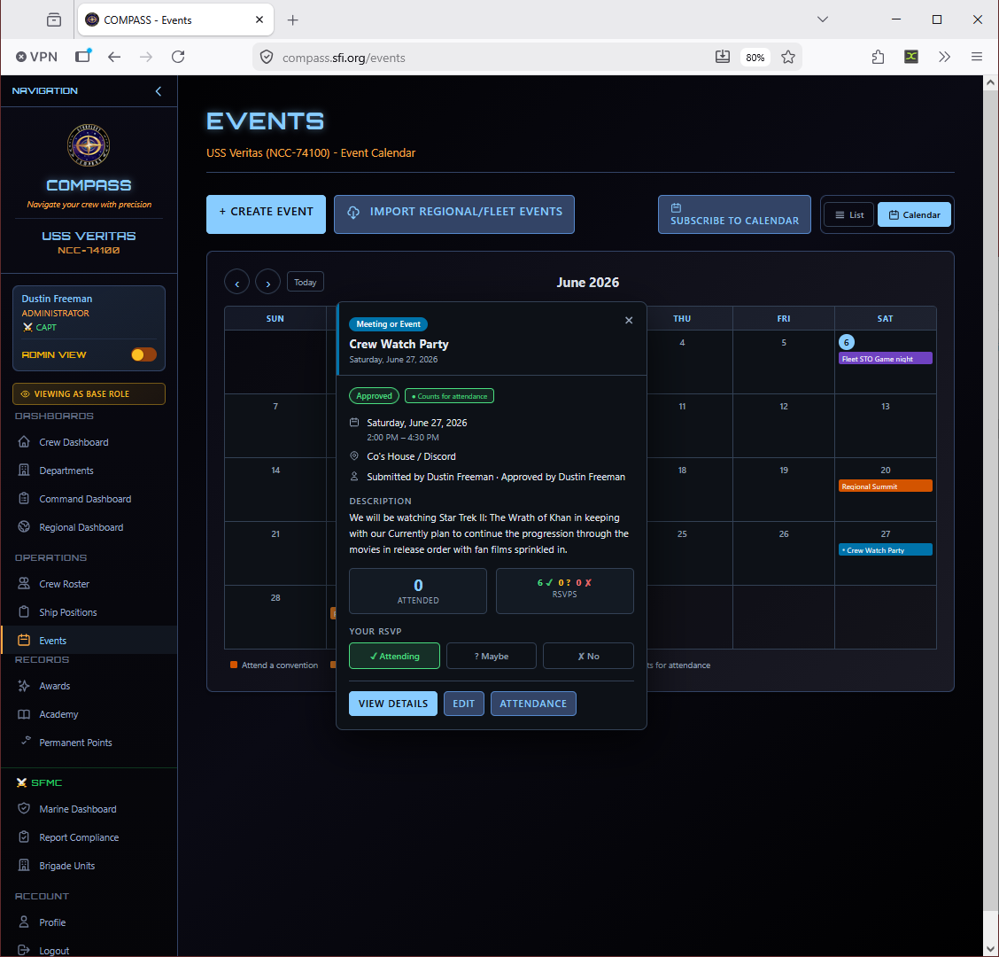

# Events

Event tracking builds the activity record that drives promotion eligibility, award nominations, and monthly reports. Every meeting, activity, and convention appearance should be logged.

Go to **Events** in the left navigation.

---

## Creating an Event

Click **Create Event** from the Events page.

Required fields:

- **Event Name** — A descriptive title (e.g., "June Monthly Meeting", "Regional Summit 2026")
- **Event Type** — Determines point value (see below)
- **Event Date** — The date the event takes (or took) place

Optional fields:

- **Event Time** — Leave it blank for an **all-day** event. An all-day event shows only its date, with no time, everywhere in COMPASS and in calendar feeds. Enter a time and it is shown to each member in their own time zone.
- **End Date / End Time** — For multi-day events such as conventions.
- **Location** and **Description**
- **Counts for Attendance Tracking** — Pre-set from the event type. Leave it on for events where you take attendance; turn it off for things like articles or recruiting credit.
- **Event Visibility**
- **Charity Amount Raised** — For charity events.
- **Attendance** — For an event that has already happened, you can check off who attended right on the create form. You can also record it later.

New events are created as **pending** and are approved by an officer who holds event-approval authority for the ship. Officers who can approve will see an **Approve Event** button on the event page.

---

## Repeating Events

If your chapter meets on a regular schedule, create the meeting once as a **repeating event** instead of entering every date by hand.

On the create form, use the **Repeats** section:

| Option | What it does |
|---|---|
| **Does not repeat** | A single event (the default). |
| **Daily** | Every day. |
| **Weekly** | Every week, on one or more days you pick under **On** (e.g. Tue and Thu). |
| **Every other week** | Every second week, on the days you pick. |
| **Monthly** | Once a month. The choices are built from the event date you entered — see below. |

**Monthly choices.** Pick an Event Date first; COMPASS then offers the patterns that fit it. For a date of Saturday, October 31, for example, you would be offered:

- **The 5th Saturday (only months that have one)**
- **The last Saturday**
- **The 31st** — months without a 31st are skipped, not moved
- **The last day of the month**

A date in the first four weeks offers "The 1st/2nd/3rd/4th *weekday*" instead. If you want "the end of the month" every month, choose **The last day of the month**, not the 31st.

**Ends.** Choose when the series stops:

- **Never** — keeps going until you end it
- **On** a specific date
- **After** a number of occurrences (up to 500)

**Preview.** As you fill in the options, a **Preview** lists the actual dates that will be created, and lists any months that will be skipped. Check it before you submit — it is calculated by the same code that creates the events, so what you see is what you get.

Click **Create Repeating Event** to save.

### Rules for repeating events

- **A repeating event must start today or later, and needs a start time.** To record meetings that already happened, enter them as single events.
- **Attendance and charity amounts are not entered on the create form.** Each date is its own event; record attendance on each one after it happens.
- **COMPASS creates the dates about six months ahead** and tops them up automatically each night, so a "Never" series always has the next half year on the calendar.
- **Approval happens once, for the whole series.** On any occurrence of a pending series, an approver will see **Approve Series**. Approving it approves every upcoming occurrence. Past occurrences are not changed.

On each occurrence's page, a **Repeating event** banner describes the pattern (e.g. "Every week on Tuesday") and shows whether the series is pending or has ended.

---

## Editing a Repeating Event

Open the occurrence you want to change and click **Edit Event**. The edit page asks what the change applies to:

- **This event only** — changes just this date. Use this to move one meeting or change its location.
- **This and following occurrences** — changes this date and every one after it.
- **All future occurrences** — changes every occurrence that hasn't started yet, including ones earlier than the one you opened.

When you choose one of the series options, the **Repeats** section appears so you can change the pattern itself (for example, moving from Tuesdays to Thursdays, or setting an end date).

Things to know:

- **Occurrences that have already started are never changed by a series edit.** Your history stays exactly as it happened.
- **A series edit overrides one-off changes to future dates.** If you moved next week's meeting by hand and then edit "all future occurrences", next week follows the new series settings.
- Before you save, COMPASS shows what the change will do — how many dates are affected, and whether any of them already have attendance recorded.

---

## RSVPs and Change Notices

Events that count for attendance show an **RSVP** section, so crew can say whether they are attending. RSVP closes 24 hours after the event starts.

When a chapter event — single or repeating — **moves** (date, time, or switching to/from all-day), **changes location**, or is **cancelled**, every member who RSVP'd **Attending** or **Maybe** is notified automatically.

- Renaming an event or editing its description does **not** notify anyone.
- Nobody is notified about a change they made themselves, and events already past are skipped.
- A series edit that touches several dates a member RSVP'd to arrives as **one** message listing each changed date, not one message per date.
- Members control this in their notification preferences under **Event Changes**.

---

## Event Types

Each event type has a base point value, a uniform multiplier, and a default for whether it counts for attendance. The full list, with point values, is in [How Promotion Points Work](../reference/promotion-points.md).

Your ship can adjust the values in **Ship Settings → Event Points**.

---

## Recording Attendance

Open the event and click **Record Attendance** (or **Edit Attendance** once some has been entered). Check each crew member who attended, and mark who was in uniform.

!!! tip
    Enter attendance the same day or the next morning. Remembering who attended two weeks later is much harder — and missing attendance means missing points toward promotion eligibility.

---

## Plan / Host Credit

Members who **plan or host** an event can be credited directly on that event — you no longer need to create a separate "Plan or Host an event" entry just to give someone that credit.

On any event you can manage (you hold attendance permission, or you created the event), open the event and click **Plan / Host Credit**. A window lists your active crew — check everyone who planned or hosted, then click **Save Host Credit**.

- **No one, one, or many** members can be credited on a single event.
- Host credit is worth the **"Plan or Host an event"** point value, awarded *on top of* any attendance points. A member who both attended and hosted receives both.
- Unchecking everyone and saving removes all host credit from the event.

Credited members appear in a **Planned / Hosted By** list on the event page, and their host points flow into promotion totals and reports automatically. Host credit is **not** attendance — it will not inflate attendance counts or uniform-compliance figures.

!!! note
    The standalone **"Plan or Host an event"** event type still works if you prefer it. This feature simply lets you record the same credit on the real event instead of entering a duplicate.

---

## Editing or Deleting an Event

Open the event from the Events list and click **Edit Event** to change any details. Events can be deleted if entered in error, but deletion is permanent — there's no undo.

**Deleting a repeating event** opens a window with the same choices as editing: **This event only**, **This and following occurrences**, or **All future occurrences**. It tells you how many dates will be removed. If any of them already have attendance recorded, you must tick a box confirming you want those records deleted too. Deleting "this event only" removes that one date for good — it will not be recreated.

!!! warning
    Deleting an event removes all attendance records and the associated points for all attendees. If the event was just entered with the wrong date or wrong type, edit it rather than deleting and re-entering.

---

## Sharing Events With Other Chapters

Your ship can publish an event to your region or the whole fleet so other chapters can add it to their own calendars — and you can add events other chapters have shared. See [Sharing Events Between Chapters](event-sharing.md).

---

## How Events Drive Promotions

Each attended event awards the attending crew member a number of activity points, based on the event type's configured point value. These points accumulate toward promotion eligibility requirements. You can see a member's point total and the events driving it on their crew record.

---

## Common Issues

**I forgot to log an event from last month.**
Enter it as a single event with the correct past date — no problem. Only *repeating* events are limited to starting today or later.

**A member's attendance isn't showing in their promotion record.**
Open the event and verify they're checked in the attendance list. Also check that the event is approved and that the event type has a non-zero point value in Ship Settings.

**I entered the wrong event type and points were awarded incorrectly.**
Edit the event and change the type. Points will recalculate automatically.

**My monthly meeting skipped a month.**
You probably picked a specific date such as **The 31st**, or **The 5th Saturday**, which some months don't have. The Preview lists skipped months. Edit **All future occurrences** and choose **The last day of the month** or a weekday pattern instead.

**I changed one meeting, then edited the series, and my change disappeared.**
That's by design — series edits apply to every future date. Make the one-off change again with **This event only**.

**An event I entered with no time used to show "12:00 AM".**
Events entered without a time are now true all-day events and show the date only.
