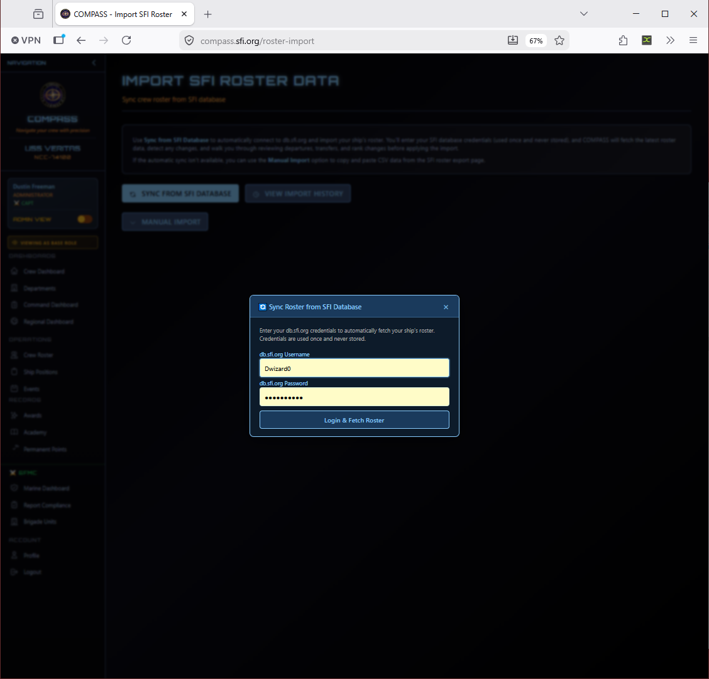
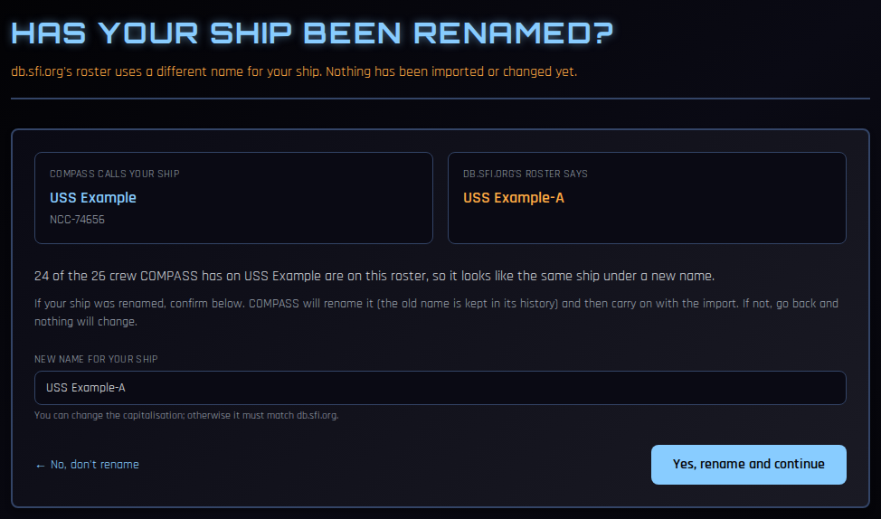

# Managing Your Roster

Your crew roster is the foundation of everything in COMPASS — promotion eligibility, event attendance, awards, and reports all depend on an accurate roster.

Go to **Crew Roster** in the left navigation to view your full ship roster.

---

## Member Statuses

| Status | Meaning |
|---|---|
| **Active** | Full member, counts toward all reports and promotion tracking |
| **Reserve** | Limited participation, still on roster |
| **LOA** | Leave of Absence — temporarily inactive, intends to return |
| **Inactive** | No current participation |
| **Transferred** | Moved to another ship |
| **Retired** | Left SFI or the chapter |

!!! tip
    Use **LOA** for members who plan to return. **Inactive** is for members who have stopped participating but haven't formally left. Avoid using **Retired** unless the member has actually departed — it removes them from active reporting.

---

## Adding a Crew Member

Go to **Crew Roster → Add Member**. Required fields: SCC, full name, rank, and status. Recommended: email address and join date.

!!! warning "Duplicate SCCs"
    COMPASS won't allow two members with the same SCC on the same ship. If you get a duplicate error, check whether they're already on your roster under a slightly different name, or contact your RC if they appear on another ship.

---

## Editing a Crew Member

Click any member's name to open their profile, then click **Edit** to update their information. From a member's profile you can also update their rank, change their status, manage department assignments, and view their promotion and awards history.

---

## Importing Your Roster from SFI

If your ship's roster in db.sfi.org has changed — new members joined, ranks updated — you can re-sync directly from the Command Dashboard.

Go to **Command Dashboard → Roster Import**.

Click **Sync from SFI Database** and enter your db.sfi.org credentials when prompted. COMPASS will fetch your latest roster, detect changes (new members, rank changes, departures), and walk you through reviewing those changes before applying the import.

If the automatic sync isn't available, use **Manual Import** to paste CSV data from the SFI roster export page.

!!! note
    Credentials entered here are used once and never stored — the same as the initial ship setup.

### If your ship has been renamed

If db.sfi.org now uses a different name for your ship, the roster import notices and asks before changing anything:

- It only offers a rename when **at least half your current crew** are on the roster. Otherwise it treats the file as another ship's roster and refuses it, as before.
- You can adjust the capitalisation of the new name (db.sfi.org rosters often use capitals); otherwise it must match db.sfi.org.
- Click **Yes, rename and continue** to rename the ship and carry on with the import. The old name stays in the ship's history. Click **No, don't rename** to stop without changing anything.

Crew who told COMPASS "my ship was renamed" (see [Check Your Chapter](../crew/chapter-check.md)) are sorted out by this import.

---

## Transfers

Members change ships themselves by updating their chapter on db.sfi.org; COMPASS follows it. There is nothing for you to approve. Members heading to your ship appear under **Incoming Crew** in the left navigation.

See **[Crew Transfers](crew-transfers.md)** for what you see when crew arrive or leave, and when to ask your RC for a direct transfer.

---

## Ship Positions

Go to **Ship Positions** in the left navigation to view and manage formal position assignments (CO, XO, Department Heads, etc.).

 1.png)

To assign or change a position, go to **Ship Positions → Manage Positions**.

 1.png)

---

## Departments

Go to **Departments** in the left navigation to organise your crew into departments, assign department heads, and run department activity reports.

Crew not assigned to a department appear in the **Unassigned** count on the Command Dashboard.

See **[Departments](departments.md)** for the full walkthrough.

---

## Roster Best Practices

- Audit monthly before submitting reports
- Enter new members promptly — don't wait until report time
- Use LOA for members who intend to return, not Inactive
- Never delete members — change their status instead; historical data is preserved

---

## Common Issues

**I added a member but they can't log in.**
New members get a **Welcome to COMPASS** email with a link to set their password. The link expires after 24 hours; after that they can use **Forgot password?** on the login page with their SFI username. If email isn't working for them, they can click **Verify with your db.sfi.org account** on the login page instead. See [Setting Up or Recovering Your Account](../crew/verify-account.md).

**The roster import says "Wrong ship detected!"**
The roster's ship name doesn't match your ship, and fewer than half your crew are on it, so COMPASS thinks it's another ship's roster. Check you exported your own chapter's roster. If your ship really was renamed and the crew is mostly the same, the import offers a rename instead (see [above](#if-your-ship-has-been-renamed)).

**A member appears on two ships.**
Contact your RC to resolve. Crew can only have one active assignment at a time.

**Roster import shows a member with the wrong rank.**
db.sfi.org is the source of truth for rank. If the rank is wrong in SFI's database, it needs to be corrected there first, then re-imported.
