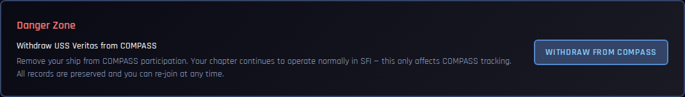
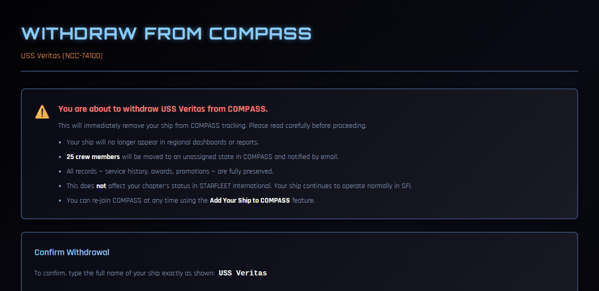

# Withdrawing Your Ship from COMPASS

If your chapter decides to stop using COMPASS, the CO can withdraw the ship. This page explains what withdrawal does, what it doesn't do, and how to come back.

!!! note "About the screenshots"
    The screenshots on this page come from a test copy of COMPASS.

---

## What withdrawal does — and doesn't do

Withdrawing is about **COMPASS only**. Your chapter keeps operating in STARFLEET International exactly as before. Nothing changes on db.sfi.org.

When you withdraw:

- **The ship stops being tracked.** It no longer appears on the Regional Dashboard or in reports.
- **Your crew become unassigned in COMPASS.** Each active crew member's assignment is closed, and they get an email letting them know. Their accounts stay active.
- **Ship positions and roles end.** Positions such as XO, OPS and department heads are closed, along with the access that came with them.
- **Your Regional Coordinator is notified.**
- **Every record is kept.** Service history, awards, promotions, events and points all stay in COMPASS.

!!! warning "This takes effect immediately"
    There's no grace period. As soon as you confirm, your crew are unassigned and the emails are on their way. If you only want to pause for a while, you don't need to withdraw — an inactive ship costs nothing.

---

## Who can withdraw

Only the **Commanding Officer**. The XO and other officers don't see the option.

If the CO isn't available and the chapter needs to leave COMPASS, contact your Regional Coordinator.

---

## How to withdraw

1. Go to **Command Dashboard → Ship Settings**.
2. Scroll to the bottom and find **Withdraw *your ship* from COMPASS**.

    

3. Click the button. The confirmation page tells you exactly how many crew members will be affected.

    

4. Read the list carefully.
5. Type your ship's name exactly as shown — capitals and spaces included. The **Withdraw from COMPASS** button stays greyed out until the name matches.
6. Click **Withdraw from COMPASS**.

You're returned to your dashboard with a confirmation.

---

## Coming back

You can re-join COMPASS at any time:

1. Go to the COMPASS login page and click **Add Your Ship to COMPASS**.
2. Enter your ship's details as for a new ship. See [Getting Started](getting-started.md).

If your registry matches the withdrawn ship, COMPASS **reactivates** it rather than creating a new one. The ship is restored, the person re-joining becomes its CO, and all of its history — awards, promotions, events — is still there.

Your crew aren't restored automatically. They come back onto the ship with your next roster import.

---

## Common Questions

**Will my crew lose their points or awards?**
No. Everything earned is kept on each member's own record and comes with them to whatever ship they join next.

**Do I need to tell SFI?**
No. Withdrawal doesn't change anything on db.sfi.org or your chapter's standing in SFI.

**What happens to our announcements and Facebook, X or Discord channels?**
Your chapter's announcements stay in COMPASS but nobody on the ship sees them. Nothing is posted to your channels after withdrawal.

**I'm the CO and I'm leaving the chapter, but the chapter is staying.**
Don't withdraw. Use **Leave Ship** instead — see [Joining or Changing Ships](../crew/changing-ships.md). Your Regional Coordinator appoints the new CO.
