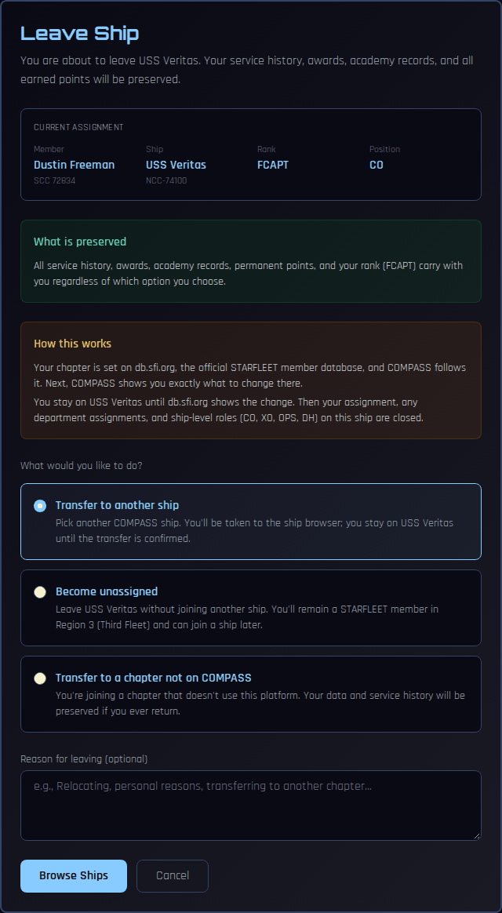
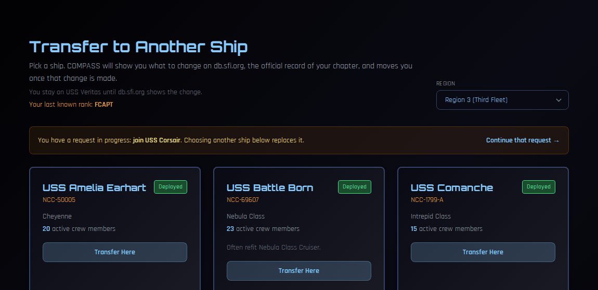
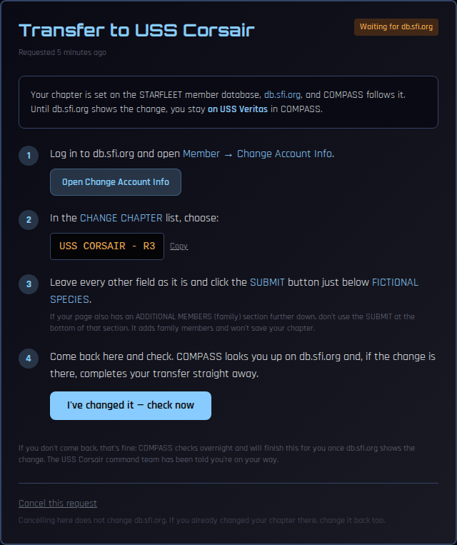
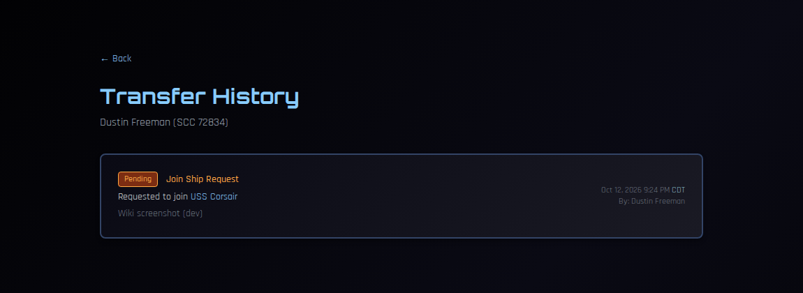

# Joining or Changing Ships

Under SFI policy you can move to another chapter at any time, for any reason. This page walks through transferring to another ship, leaving your ship, and joining a ship when you don't have one.

**Your history comes with you.** Your service history, awards, academy records, permanent points and rank are kept whichever option you choose.

!!! note "About the screenshots"
    The screenshots on this page come from a test copy of COMPASS.

---

## How it works

Your chapter is officially recorded on **db.sfi.org**, the STARFLEET member database. COMPASS follows db.sfi.org; it doesn't move you on its own say-so.

So every move has two halves:

1. **In COMPASS**, you say where you're going. COMPASS then shows you exactly what to change on db.sfi.org.
2. **On db.sfi.org**, you change your chapter.

As soon as COMPASS sees the change on db.sfi.org, it completes your move. **Until then you stay where you are.** Nothing in COMPASS changes if you never make the db.sfi.org change.

You don't need anyone's approval. The new ship's command team is told you're on your way.

---

## Transferring to another ship

### 1. Start from your ship

Click **Leave Ship**, either on [My Record](my-record.md) or at the bottom of your **Profile**.

Choose **Transfer to another ship**, optionally add a reason, and click **Browse Ships**.

### 2. Pick a ship

The ship browser lists the operating ships in your region, with their crew size. Use **Region** at the top right to look in another region.

Click **Transfer Here** on the ship you want. You can add an optional note to the new command team (a little about yourself is nice), then click **Continue**.

### 3. Change your chapter on db.sfi.org

COMPASS shows you the exact steps:

1. Click **Open Change Account Info** and sign in to db.sfi.org.
2. In the **CHANGE CHAPTER** list, choose the chapter COMPASS shows you, for example **USS CORSAIR - R3**. Use **Copy** if it helps you find it.
3. Leave every other field as it is and click the **SUBMIT** button just below **FICTIONAL SPECIES**.

!!! warning "Family memberships"
    If your db.sfi.org page has an **ADDITIONAL MEMBERS** section further down, don't use the SUBMIT button at the bottom of that section. It adds family members and won't save your chapter.

### 4. Come back and check

Back in COMPASS, click **I've changed it — check now**. COMPASS looks you up on db.sfi.org and, if the change is there, completes your transfer straight away.

If you don't come back, that's fine: COMPASS checks overnight and finishes the transfer once db.sfi.org shows the change.

While a transfer is waiting, a banner at the top of COMPASS reminds you, with a **Finish it** link back to these steps.

---

## Leaving without joining another ship

From **Leave Ship**, choose **Become unassigned**, then follow the steps. On db.sfi.org you'll set your chapter to **---UNASSIGNED---**.

You stay a STARFLEET member in your region, and your Regional Coordinator looks after unassigned members. You can join a ship again later.

## Moving to a chapter that isn't on COMPASS

From **Leave Ship**, choose **Transfer to a chapter not on COMPASS** and type the chapter's name if you know it. On db.sfi.org, pick that chapter. COMPASS keeps your record in case you ever come back.

---

## Joining a ship when you don't have one

If you're unassigned, your left navigation shows **Find a Ship**.

1. Click **Find a Ship** to open the ship browser.
2. Click **Transfer Here** on the ship you want to join.
3. Follow the db.sfi.org steps above.

---

## Changing your mind

- **Pick a different ship:** start again from Leave Ship or the ship browser. Choosing a new destination replaces your open request; you can only have one at a time.
- **Cancel:** on the request page, click **Cancel this request**. Cancelling only affects COMPASS. If you already changed your chapter on db.sfi.org, change it back there too, or COMPASS will still follow it.

---

## Your transfer history

On [My Record](my-record.md), click **Transfer History** to see every move you've requested or made and where each one stands.

---

## Things to know

- **Positions and roles end when you leave.** When the move completes, your assignment on your old ship closes, along with any department assignments and ship roles there (such as CO, XO, OPS or department head).
- **If you're the CO or XO,** COMPASS warns you before you leave. A ship whose CO leaves has no CO until the Regional Coordinator or an administrator appoints one; the CO appoints a new XO.
- **Your points come with you.** Promotion points are counted across your whole career, not per ship.
