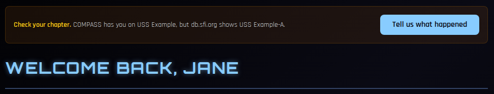
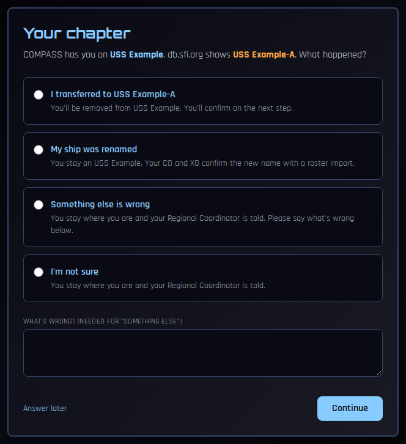
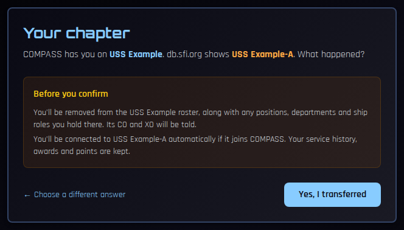

# Check Your Chapter

Sometimes db.sfi.org shows you on a chapter COMPASS doesn't recognise, while COMPASS has you on a ship. That usually means one of two things: you transferred to a chapter that isn't on COMPASS, or your ship has been renamed on db.sfi.org. COMPASS can't tell which, so it asks you instead of guessing.

---

## Where you'll see it

A **Check your chapter** banner appears at the top of your dashboard. You may also be taken straight to the question right after [setting up your account](verify-account.md).

Click **Tell us what happened**.

---

## Answering

| Answer | What happens |
|---|---|
| **I transferred to *the new chapter*** | You confirm on the next page, then you're removed from your COMPASS ship and its CO and XO are told. If that chapter joins COMPASS, you're connected to it automatically. |
| **My ship was renamed** | You stay on your ship. Your CO and XO are asked to confirm the new name; they do that with a roster import, which updates the ship's name in COMPASS. |
| **Something else is wrong** | You stay where you are, and your Regional Coordinator is told. Say briefly what's wrong in the box — it's required for this answer. |
| **I'm not sure** | You stay where you are, and your Regional Coordinator is told. |

Click **Continue**. If you're not ready, **Answer later** takes you back to your dashboard; the banner stays until you answer.

### Confirming a transfer

Because **I transferred** takes you off your ship, COMPASS shows exactly what will happen before anything changes:

Click **Yes, I transferred** to go ahead, or **Choose a different answer** to go back. Your service history, awards and points are always kept.

---

## Common Questions

**The banner went away on its own.**
That's expected. It disappears as soon as db.sfi.org and COMPASS agree again — for example after your CO's roster import renames the ship.

**I answered, but I picked the wrong option.**
Contact your Regional Coordinator. If you said you transferred and you hadn't, your CO's next roster import will put you back on the ship; your positions and roles will need re-assigning.

**I'm the CO or XO and I said the ship was renamed.**
Run a roster import for your ship. It will show the new name and ask you to confirm it. See [Managing Your Roster](../co-guide/roster.md#if-your-ship-has-been-renamed).
