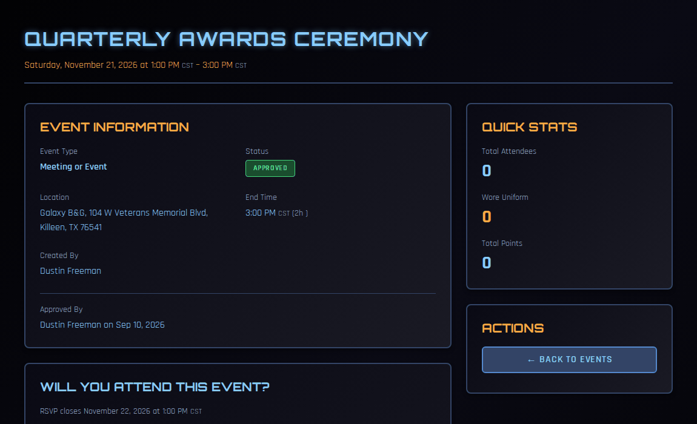

# Events and RSVPs

Your ship's events are where most of your promotion points come from. This page covers finding events, telling your command team whether you're coming, what happens when an event changes, and putting your ship's calendar on your phone.

!!! note "About the screenshots"
    The screenshots on this page come from a test copy of COMPASS. Personal details are blurred.

---

## Finding events

Click **Events** in the left navigation. Switch between **List** and **Calendar** at the top right, and use **Filters** to narrow the list.

Your next few events also appear under **Upcoming Events** on your [dashboard](index.md#your-dashboard).

Open an event to see its details. Times are shown in your time zone; an all-day event shows only its date.

---

## RSVPing

Events that count for attendance have a **Will you attend this event?** section.

1. Open the event.
2. Under **Your RSVP**, click **Attending**, **Maybe** or **Not Attending**. Your choice is saved straight away and highlighted.
3. Changed your mind? Click a different answer. You can change it until RSVP closes, **24 hours after the event starts**.

**Total Responses** at the bottom shows how many people are attending, maybe, or not attending. The list of names is visible to your command team and to whoever created the event.

### RSVPing for your family

If you have a **family membership** with SFI, your family members are listed under **Family Members**, each with their own buttons. RSVP for each person separately. Family groups come from the SFI roster, so if someone is missing, check the family membership on db.sfi.org.

### An RSVP is not attendance

Your RSVP tells your command team who to expect. **It doesn't earn points.** After the event, your command team records who actually attended and who wore uniform, and that's what puts the points on your record. If you attended an event and it's still missing from [My Record](my-record.md) a few days later, let your CO know.

---

## When an event changes

If you RSVP'd **Attending** or **Maybe**, COMPASS tells you when the event:

- **moves** — a new date or time, or switching to or from all-day
- **changes location**
- **is cancelled**

Renaming an event or editing its description doesn't send a notice, and nothing is sent for events that have already happened.

For a repeating event, such as a weekly meeting, a change that affects several dates you RSVP'd to arrives as **one** notice listing each changed date.

Notices arrive by email, push and Discord, depending on your [notification settings](notifications.md). The **Event Changes** switch controls them. They're also kept in your **Notification History**.

!!! tip
    If an event is cancelled, its RSVPs go with it. If it's rescheduled as a new event, RSVP again.

---

## Adding your ship's calendar to your phone

You can subscribe to your ship's events in Google Calendar, Apple Calendar or Outlook. New events appear on their own as they're approved.

1. On the **Events** page, click **Subscribe to Calendar**.
2. Copy the **Subscription URL**.
3. Add it to your calendar app:
    - **Google Calendar** (on a computer): **Other calendars → + → From URL**, paste, then **Add calendar**.
    - **Apple Calendar**: on a Mac, **File → New Calendar Subscription**. On an iPhone, **Settings → Calendar → Accounts → Add Account → Other → Add Subscribed Calendar**.
    - **Outlook**: **Add calendar → Subscribe from web**.

Calendar apps refresh subscriptions on their own schedule, so a brand-new event can take a few hours to appear.

!!! note
    If the window says the feed is disabled or not available yet, ask your CO or XO to turn it on in Ship Settings.

---

## Suggesting an event

Crew members can create events too. Click **Create Event** on the Events page and fill in the form. Your event is submitted as **pending** and appears on the calendar once your command team approves it. See [Events](../co-guide/events.md) for what each field means.
