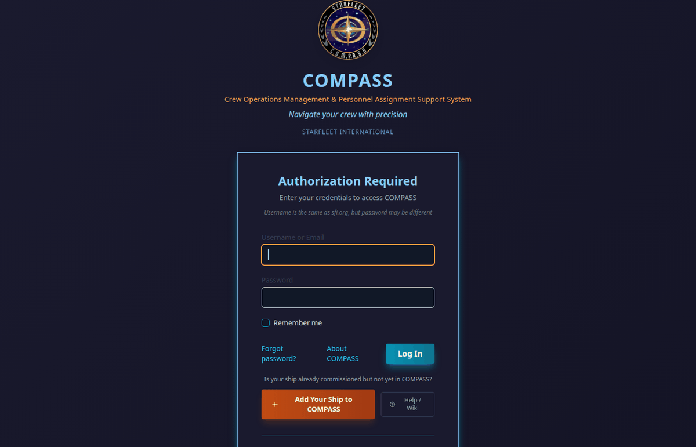
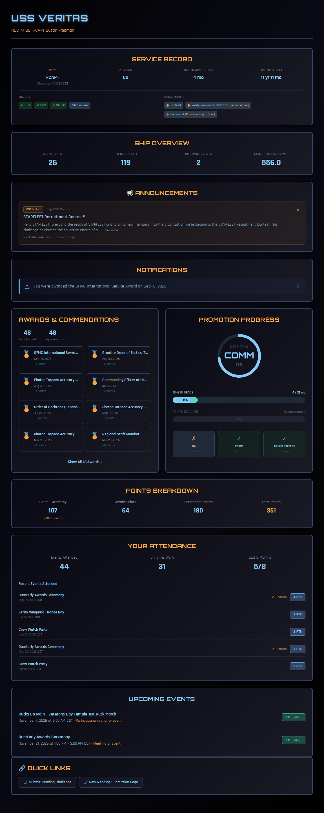
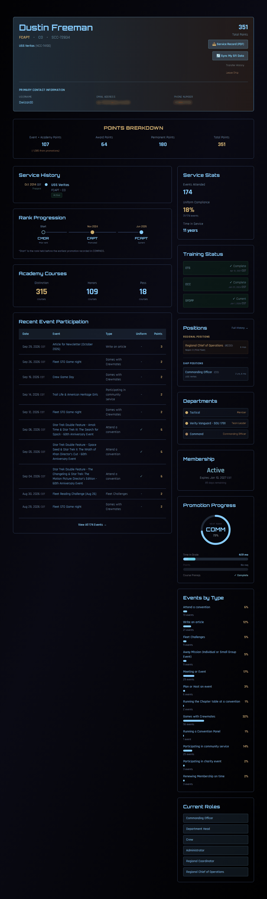
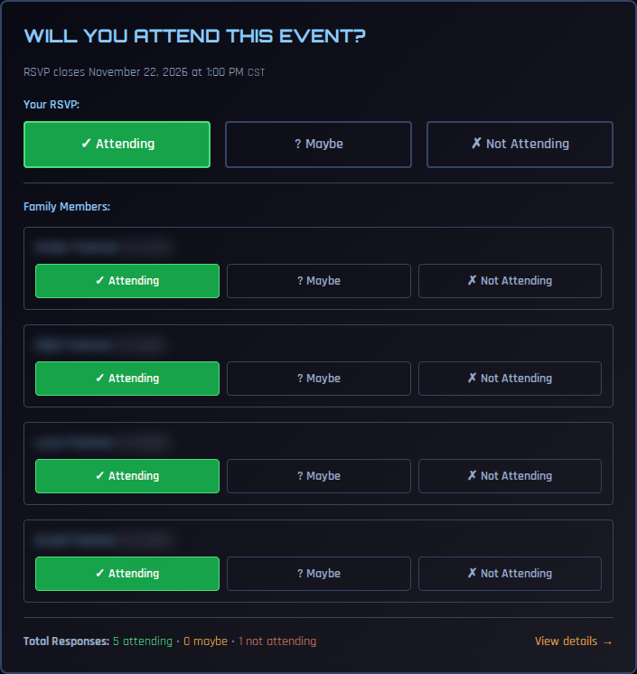
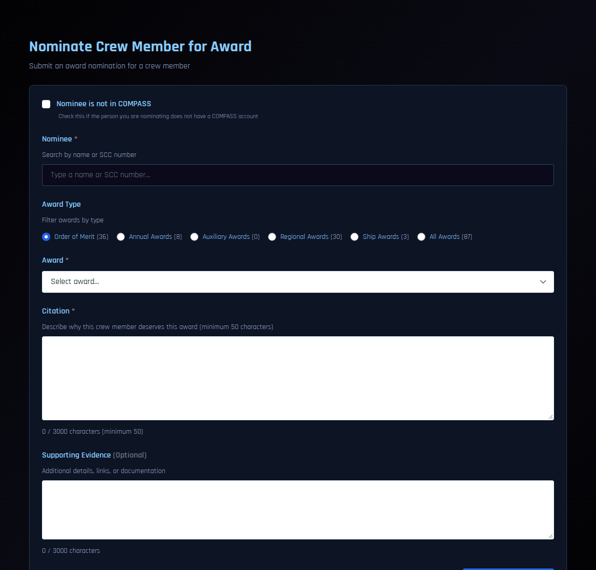
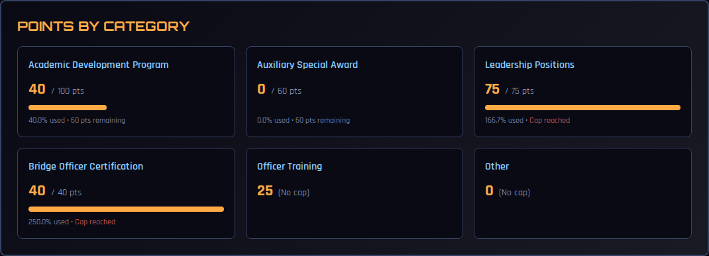
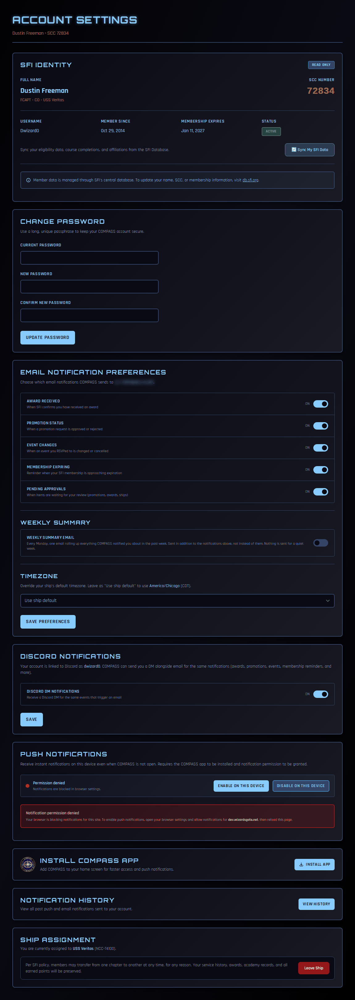

# Crew Member Guide

This guide is for crew members — anyone who is not the CO or XO of their ship. It covers what you see when you log in, how to keep track of your own service record, and how to take part in your ship's events.

!!! note "About the screenshots"
    The screenshots in this guide come from a test copy of COMPASS. Some personal details are blurred, and the numbers on your own pages will of course be different.

---

## Getting Your Account

You don't sign up for COMPASS yourself. When your CO adds your ship's roster to COMPASS, you get a **"Welcome to COMPASS — Your Account is Ready"** email. It lists your SCC, ship, rank and username, and has a **Set Your Password** button.

- The link in that email expires after **24 hours**. If it has expired, use **Forgot password?** on the login page to get a new one.
- If you never received a welcome email, check your spam folder, then ask your CO. Your CO can confirm you're on the roster.

## Logging In

Go to [compass.sfi.org](https://compass.sfi.org) and sign in with your **username or email** and your COMPASS password.

Your username is the same as on **db.sfi.org**, but your password is separate — changing one does not change the other.

Tick **Remember me** on a device you use often so you stay signed in.

!!! tip "Install COMPASS as an app"
    COMPASS can be installed on your phone or computer like an app. Go to **Profile → Install COMPASS App**, or use your browser's "Add to Home Screen" option. Installing it is also what lets you receive push notifications.

---

## Finding Your Way Around

The menu on the left is grouped into sections. As a crew member you will usually see:

| Section | Items |
|---|---|
| **Dashboards** | **Crew Dashboard**, **Departments** |
| **Operations** | **Ship Positions**, **Events**, and **Voting** if your chapter uses it |
| **Records** | **Awards**, **Academy**, **Permanent Points** |
| **Account** | **My Record**, **Profile**, **Help / Wiki**, **Logout** |

The **Notifications** bell at the top of the menu shows a count when you have something new.

If you hold a position on your ship or in your region, you'll see extra items for that role. Those are covered in the [Commanding Officer](../co-guide/index.md) and [Regional Coordinator](../rc-guide/index.md) guides.

---

## Your Dashboard

After logging in you land on the **Crew Dashboard**, a summary of where you stand.

From top to bottom:

- **Service Record** — your rank (and since when), position, time in grade, time in service, training badges (OTS, OCC, SFDPP, course count) and your departments.
- **Ship Overview** — active crew, events in the last 12 months, upcoming events and service hours for your ship.
- **Announcements** — messages from your command team, region or the fleet.
- **Notifications** — recent items for you, such as an award you received.
- **Awards & Commendations** — your awards, newest first. Click **Show All** to see the full list.
- **Promotion Progress** — your next rank and how close you are, with checks for time in grade, points and course prerequisites.
- **Points Breakdown** — event and academy points, award points, permanent points and your total.
- **Your Attendance** — events attended, uniforms worn, and your recent events with the points each one earned.
- **Upcoming Events** — your ship's next events.
- **Quick Links** — links your CO has set up, such as a reading challenge form or your ship's website.

---

## My Record

**My Record** (under Account) is your complete service record: ships, promotions, awards, training, events and points, with a **Service Record (PDF)** button for a printable copy that leaves out your personal contact details.

See **[My Record and Your Service Record](my-record.md)** for a tour of every section, the PDF, and how to fix details that are wrong.

---

## Promotion Progress

Your **Promotion Progress** card (on the dashboard and on My Record) shows the next rank you can be promoted to and three checks:

- **TIG** — whether you've served enough time in your current grade
- **Points** — whether you have the points the next rank requires
- **Course Prereqs** — whether you've completed the required Academy courses

When all three are green you are eligible. Promotions on a ship are put forward by your command team, so if you think you're eligible, talk to your CO.

Not sure where the numbers come from? See [How Promotion Points Work](../reference/promotion-points.md) for the point value of every event type, academy grade, award, and permanent point award, plus the point cost and time in grade for each rank.

!!! note "Not assigned to a ship?"
    Members without a ship request promotions themselves. See [Requesting a Promotion (Unassigned)](unassigned-promotion.md).

---

## Events and RSVPs

Go to **Events** to see your ship's calendar. Open an event and choose **Attending**, **Maybe** or **Not Attending** to let your command team know whether you're coming. If an event you RSVP'd to moves or is cancelled, COMPASS tells you.

Your RSVP isn't your attendance: your command team records who attended after the event, and that's what earns points.

See **[Events and RSVPs](events-rsvp.md)** for RSVPing for family members, change notices, adding your ship's calendar to your phone, and suggesting an event.

---

## Awards and Nominations

Go to **Awards** to see the awards you've received.

To recognise a shipmate, go to **Awards → Nominate**.

1. Search for the **Nominee** by name or SCC. If they don't have a COMPASS account, tick **Nominee is not in COMPASS**.
2. Choose an **Award Type** to narrow the list, then pick the **Award**.
3. Write a **Citation** of at least 50 characters explaining why they deserve it. Add any **Supporting Evidence** you have.
4. Submit. Your nomination goes to your CO for review before moving on to regional or fleet approval.

See the [Awards guide](../co-guide/awards.md) for advice on writing a strong citation.

---

## Academy and Permanent Points

**Academy** shows SFI Academy course completions for your ship, including how many courses each member has passed with Distinction, Honors or Pass. Your own course counts also appear on My Record.

**Permanent Points** shows your permanent points — awards, leadership positions, OTS/OCC completions, and other sources — grouped by category.

Permanent points never reset and are never spent on a promotion. See [How Promotion Points Work](../reference/promotion-points.md#permanent-points) for the values and the per-category caps.

!!! info "Why doesn't my total add up?"
    Each category has a **cap**. Points awarded above the cap are kept on your record but don't count toward your total. The bar under each category shows how much of the cap you've used; "Cap reached" means extra points in that category won't raise your total.

---

## Your Profile and Notifications

Go to **Profile** to manage your account.

- **SFI Identity** — your name, SCC, username and membership, read only from db.sfi.org
- **Change Password** — your COMPASS password
- **Email Notification Preferences** and **Timezone**
- **Discord Notifications** and **Push Notifications**
- **Install COMPASS App** and **Notification History**
- **Ship Assignment** — your current ship, with a **Leave Ship** button

See **[Notifications](notifications.md)** for setting up email, push and Discord notices, linking your Discord account, and using your Notification History.

---

## Changing Ships

Under SFI policy you can move to another chapter at any time. Click **Leave Ship** (on My Record or your Profile) to transfer to another ship, become unassigned, or move to a chapter that isn't on COMPASS. Your service history, awards, academy records, points and rank all come with you.

Your chapter is officially set on db.sfi.org, so COMPASS shows you exactly what to change there and completes your move once it sees the change.

See **[Joining or Changing Ships](changing-ships.md)** for the step-by-step walkthrough, including joining a ship when you don't have one.

---

## Common Issues

**I never got a welcome email, or the link expired.**
Use **Forgot password?** on the login page with your SFI username or email. If COMPASS doesn't recognise you, ask your CO to check that you're on the ship's roster.

**My rank, name or email in COMPASS is wrong.**
These come from db.sfi.org. Get them corrected there first; COMPASS picks up the change the next time your CO imports the roster.

**My membership expiration or OTS/OCC status is out of date.**
Click **Sync My SFI Data** on My Record or your Profile.

**An event I attended isn't on my record.**
Attendance is entered by your command team after the event, and only approved events count. If it's still missing a few days later, let your CO know.

**My permanent points total is lower than the points I've been awarded.**
Some categories are capped — see [Academy and Permanent Points](#academy-and-permanent-points).

**I'm not receiving notifications.**
Check your **Email Notification Preferences** on your Profile and your spam folder. For push notifications, click **Enable on this Device** on each device, and make sure your browser allows notifications for compass.sfi.org.
