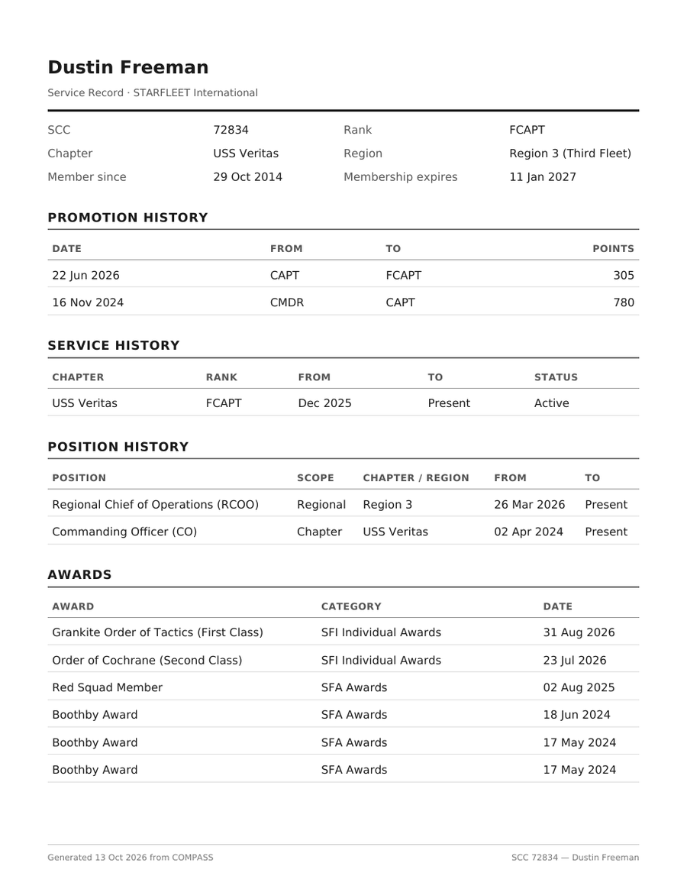

# My Record and Your Service Record

**My Record** is your complete STARFLEET service record in COMPASS: your ships, promotions, awards, training, events and points in one place. From it you can download a printable **Service Record PDF**.

!!! note "About the screenshots"
    The screenshots on this page come from a test copy of COMPASS. Some personal details are blurred.

---

## Opening My Record

Click **My Record** under **Account** in the left navigation.

You can only see your own record. Your command team and regional staff can see the records of members they oversee.

---

## What's on the page

### The header

Your name, rank, position, SCC and ship, with your **Total Points** at the top right. Below that is your contact information as COMPASS has it: username, email and phone. These come from db.sfi.org. To change them, see [Fixing wrong details](#fixing-wrong-details).

### Points Breakdown

| Column | What it counts |
|---|---|
| **Event + Academy Points** | Points from events you attended or hosted, plus academy courses. If points have been spent on a promotion, the amount spent is shown underneath. |
| **Award Points** | The point value of your awards. |
| **Permanent Points** | Your permanent points, after the per-category caps. |
| **Total Points** | What counts toward your next promotion. |

See [How Promotion Points Work](../reference/promotion-points.md) for how each pool is earned and why event points are spent on promotion while award and permanent points are not.

### Service History

Every ship you've served on in COMPASS, with dates, rank and status. Your current ship shows **Present**.

### Rank Progression

A timeline of your promotions, oldest on the left. The first point, **Start**, is the rank you held before the earliest promotion COMPASS has on record. The last point is your **Current** rank.

### Academy Courses

How many SFI Academy courses you've passed with **Distinction**, **Honors** and **Pass**. If you've beta-tested or created courses, those counts appear too.

### Recent Event Participation

Your ten most recent events, with type, whether you wore uniform, and the points each one earned. Click **View All** at the bottom to see every event.

### The right-hand column

- **Service Stats** — events attended, uniform compliance (the share of events you wore uniform to), and time in service
- **Training Status** — OTS, OCC and SFDPP, each with its completion date
- **Positions** — your current ship and regional positions, with how long you've held them. **Full History** lists every position you've held.
- **Departments** — the departments you belong to and your role in each
- **Membership** — whether your SFI membership is active, when it expires, and how many days remain
- **Promotion Progress** — your next rank and the three checks: time in grade, points, and course prerequisites
- **Events by Type** — what share of your events falls into each event type
- **Current Roles** — your COMPASS roles

---

## Downloading your Service Record PDF

1. Open **My Record**.
2. Click **Service Record (PDF)** at the top right.
3. The PDF downloads. It's usually four or five pages.

The PDF contains:

- Your SCC, rank, chapter, region, member-since date and membership expiration
- Promotion history, with the points each promotion used
- Service history and position history
- Awards and annual fleet awards
- Training and academy
- Event participation
- Permanent points, item by item, with the category caps applied
- Your promotion point totals

**It deliberately leaves out your date of birth, address, phone number and email.** A printed record can travel further than a web page you have to sign in to see, so it's safe to hand to a recruiter, a new chapter, or anyone else who asks for your record.

---

## Keeping it up to date

### Sync My SFI Data

COMPASS checks db.sfi.org on its own, but you can refresh your record yourself at any time:

1. Click **Sync My SFI Data** on My Record (or on your Profile).
2. Enter your **db.sfi.org** username and password.
3. COMPASS pulls in your membership expiration, OTS and OCC completions, and academy course completions.

Your SFI password is used once for this check and is never stored.

### Fixing wrong details

| What's wrong | How to fix it |
|---|---|
| Name, email or phone | Update it on [db.sfi.org](https://db.sfi.org). It reaches COMPASS the next time your command team imports the roster. |
| Rank | Rank comes from promotions recorded in COMPASS and from db.sfi.org through your command team's roster import. If it's wrong, tell your CO. |
| Membership expiration, OTS or OCC | Click **Sync My SFI Data**. |
| A missing event | Attendance is entered by your command team after the event, and only approved events count. Ask your CO. |
| A missing award | Awards are recorded once SFI confirms them. Ask your CO if one is overdue. |

---

## Transfer History

**Transfer History**, under the buttons at the top right, lists every ship move you've requested or made, with its status. See [Joining or Changing Ships](changing-ships.md).
