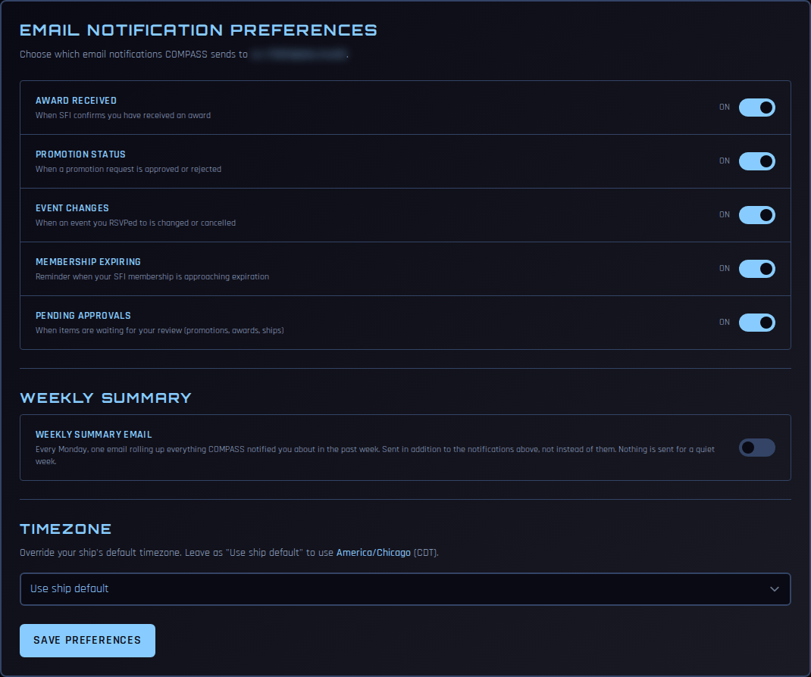
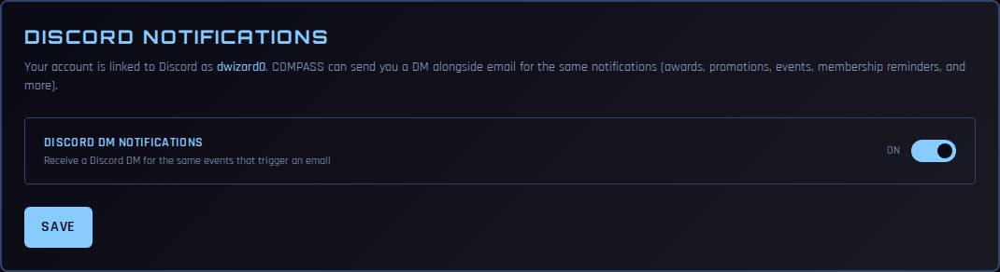
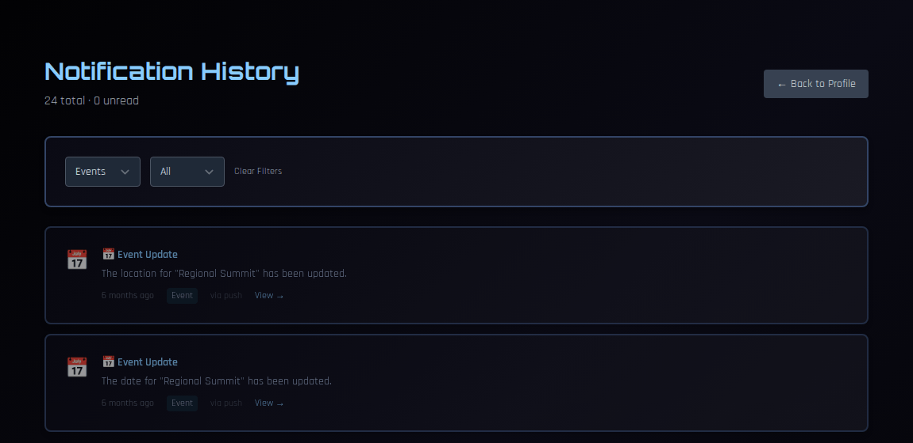

# Notifications

COMPASS can tell you when something happens that affects you: an award, a promotion decision, a change to an event you're going to, or your membership nearing expiration. You choose how you hear about it — email, Discord, push notifications on your phone, or all three — and every notice is kept in your **Notification History**.

!!! note "About the screenshots"
    The screenshots on this page come from a test copy of COMPASS.

---

## What COMPASS notifies you about

| Notice | When |
|---|---|
| **Award Received** | SFI confirms an award you've received |
| **Promotion Status** | A promotion request involving you is approved or rejected |
| **Event Changes** | An event you RSVP'd **Attending** or **Maybe** to moves, changes location, or is cancelled |
| **Membership Expiring** | Your SFI membership is approaching its expiration date |
| **Pending Approvals** | Something is waiting for your review (only if you have a command or regional role) |

---

## Email

Go to **Profile** and find **Email Notification Preferences**.

1. Turn each notice **On** or **Off** with its switch.
2. Optionally turn on the **Weekly Summary Email**: one email every Monday rolling up everything COMPASS told you about that week. It's sent in addition to the individual emails, not instead of them, and nothing is sent for a quiet week.
3. Click **Save Preferences**.

Emails go to the address on your SFI record. To change it, update it on [db.sfi.org](https://db.sfi.org); it reaches COMPASS the next time your command team imports the roster.

### Your time zone

The **Timezone** setting in the same card controls how every date and time in COMPASS is shown to you. It starts as **Use ship default** — your ship's time zone. If you live somewhere else, pick your own and click **Save Preferences**.

---

## Push notifications

Push notifications pop up on your phone or computer even when COMPASS isn't open.

1. **Install COMPASS** on the device. Go to **Profile → Install COMPASS App**, or use your browser's *Add to Home Screen* or *Install* option. On an iPhone or iPad this step is required — push notifications only work from the installed app.
2. Open the installed app and go to **Profile → Push Notifications**.
3. Click **Enable on This Device**, then **Allow** when your device asks.
4. Choose which notices to receive under **What to notify me about**.

Push is set up **per device**. Repeat these steps on each phone, tablet or computer you want notified. **Disable on This Device** turns it off for that device only.

!!! tip "\"Permission denied\""
    If the card says notifications are blocked, your browser or phone has refused permission for COMPASS. Allow notifications for compass.sfi.org in your browser or phone settings, then reload the page and try again.

Push reminders for **Membership Expiring** arrive 60, 30, 14 and 7 days before your membership expires.

---

## Discord

If your chapter's Discord server has the COMPASS bot, you can get the same notices as Discord direct messages.

### Linking your Discord account

1. In your chapter's Discord server, type **/compass link**.
2. The bot replies with a **Verify My SFI Membership** link. Click it.
3. Sign in with your **db.sfi.org** username and password. They're used once to confirm your membership and are never stored.
4. When it says you can close the window, go back to Discord.

Other bot commands you can use: **/compass update** refreshes your membership status and roles, **/compass status** shows your status, **/compass events** lists upcoming events, and **/compass points** shows your permanent points.

### Turning Discord DMs on or off

Once your account is linked, a **Discord Notifications** card appears on your Profile.

Switch **Discord DM Notifications** on or off and click **Save**. When it's on, you get a DM for the same notices that trigger an email.

---

## Notification History

Every notice COMPASS sends you is kept. Open it from the **Notifications** bell at the top of the left navigation, or **Profile → Notification History → View History**.

- The heading shows how many notices you have and how many are unread.
- Filter by type — **Awards**, **Promotions**, **Events**, **Membership**, **Approvals** or **System** — and by **Unread Only**, **All** or **Read Only**.
- Click **View →** on a notice to go to the thing it's about.
- Click **Mark read** on a single notice, or **Mark All Read** at the top.

The page opens showing unread notices. If it says "You're all caught up", choose **All** to see older ones.

---

## Not getting notified?

- **No emails:** check that each notice is switched **On** under Email Notification Preferences, and check your spam folder.
- **No push notifications:** make sure COMPASS is installed on that device and push is enabled *on that device*. Check your phone's notification settings for COMPASS.
- **No Discord DMs:** make sure your account is linked (the Discord Notifications card only appears once it is) and that **Discord DM Notifications** is on. Discord only delivers DMs if you share a server with the COMPASS bot and allow DMs from server members.
- **Missing event-change notices:** these only go to members who RSVP'd **Attending** or **Maybe**, and not for renames or description edits. See [Events and RSVPs](events-rsvp.md).
