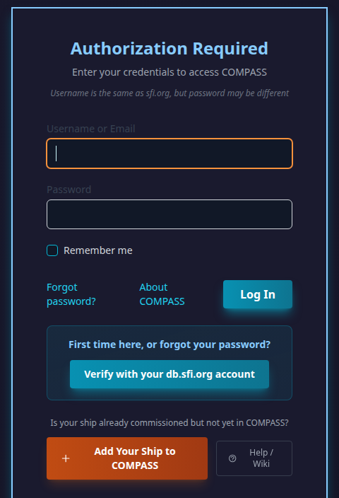
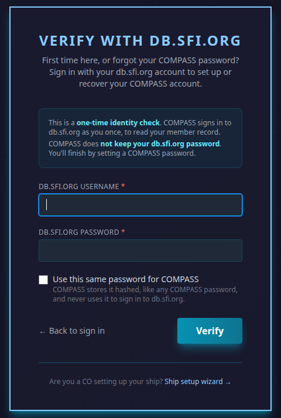
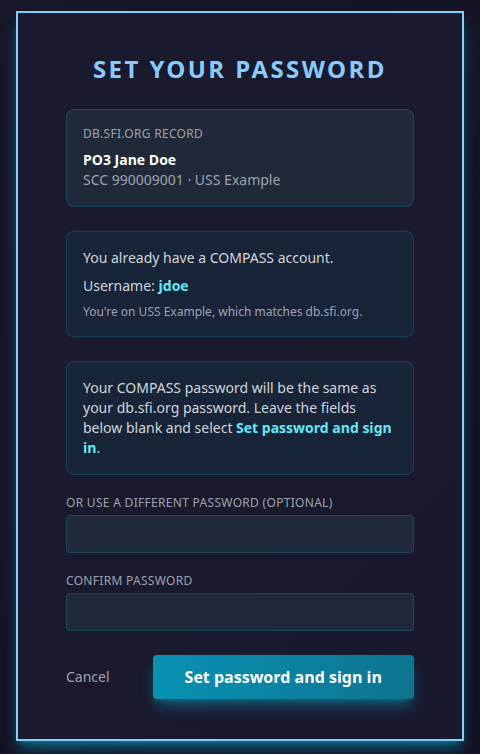
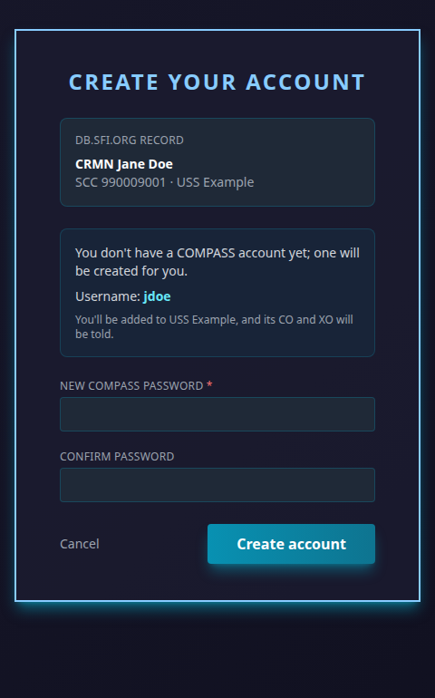

# Setting Up or Recovering Your Account

You can set up your COMPASS account, or get back into it, by signing in once with your **db.sfi.org** account. Use this if:

- you're new and never got a **Welcome to COMPASS** email, or its link has expired;
- you've forgotten your COMPASS password;
- your chapter isn't on COMPASS yet but you'd like an account ready for when it joins.

It works for any member whose membership on db.sfi.org is **active**.

---

## How to do it

### 1. Start from the login page

On [compass.sfi.org](https://compass.sfi.org), under the sign-in form, click **Verify with your db.sfi.org account**.

### 2. Sign in with your db.sfi.org username and password

COMPASS signs in to db.sfi.org as you, once, to read your member record. **It does not keep your db.sfi.org password.**

If you'd like your COMPASS password to be the same as your db.sfi.org one, tick **Use this same password for COMPASS**. COMPASS then stores it the way it stores any COMPASS password (scrambled, never readable), and never uses it to sign in to db.sfi.org. Passwords shorter than 8 characters can't be reused; you'll be asked to choose one.

Click **Verify**. It takes a few seconds.

### 3. Check what COMPASS will do, then set your password

The next page shows your db.sfi.org record, your COMPASS username, and what will happen to your ship placement. **Nothing changes until you submit this page.**

If you already have an account, you're setting a new password for it:

If you ticked **Use this same password for COMPASS**, leave both password boxes blank and click **Set password and sign in**. To use a different password instead, type it in both boxes.

If you don't have an account yet, COMPASS creates one:

If db.sfi.org doesn't list a region for you, you'll also be asked to choose your region.

When you submit, you're signed in and taken to your dashboard.

!!! note "You have 15 minutes"
    The check with db.sfi.org is good for 15 minutes. If you take longer, you'll be asked to sign in to db.sfi.org again.

---

## What happens to your ship

db.sfi.org is the official record of your chapter, so COMPASS lines your account up with it:

| db.sfi.org shows you on… | COMPASS… |
|---|---|
| The ship COMPASS already has you on | Changes nothing. |
| A different ship that's on COMPASS | Moves you there. Both ships' CO and XO are told. |
| No chapter (unassigned) | Places you with your region's unassigned members. |
| A chapter that isn't on COMPASS yet | Notes the chapter you're waiting for, and connects you automatically if it joins. |
| A ship that has left COMPASS | Notes that you're waiting for it, and reconnects you if it comes back. |
| A chapter name COMPASS doesn't recognise, while COMPASS has you on a ship | Changes nothing, and asks you what happened. See [Check Your Chapter](chapter-check.md). |

Every move shows in your transfer history, the same as any other transfer.

---

## Keeping your account safe

- Each time someone sets a password this way, COMPASS emails the address on your account. **If you get that email and it wasn't you**, change your db.sfi.org password straight away and contact your Regional Coordinator.
- Setting a password this way signs your account out everywhere else.
- Anyone who knows your db.sfi.org password can use this page, so keep that password private.

---

## Common Questions

**It says my membership isn't active.**
Only active members can verify. If you've just renewed, db.sfi.org may take a day or two to show it; try again then. If you already have a COMPASS account, you can still use **Forgot password?** on the login page to reset by email.

**It says db.sfi.org didn't accept my username and password.**
Check them on [db.sfi.org](https://db.sfi.org) first. After several failed tries COMPASS asks you to wait a minute before trying again.

**It says my account can't be set up here.**
Some accounts need a person to look at them first — for example, a suspended account or one that was removed. Contact your Regional Coordinator.

**Is my COMPASS username the same as my db.sfi.org username?**
Usually. The page shows your COMPASS username before you finish, and it's in the email COMPASS sends you.

**Can I keep signing in with my db.sfi.org password every time?**
You sign in to COMPASS with your COMPASS username and password. If you chose to reuse your db.sfi.org password, they're the same, but changing one later doesn't change the other.
