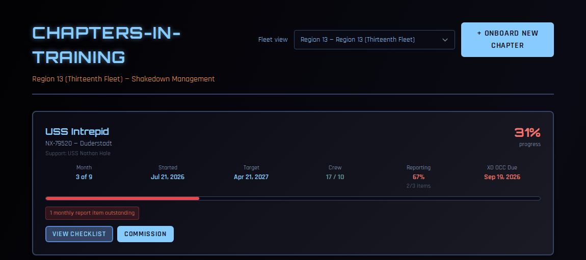
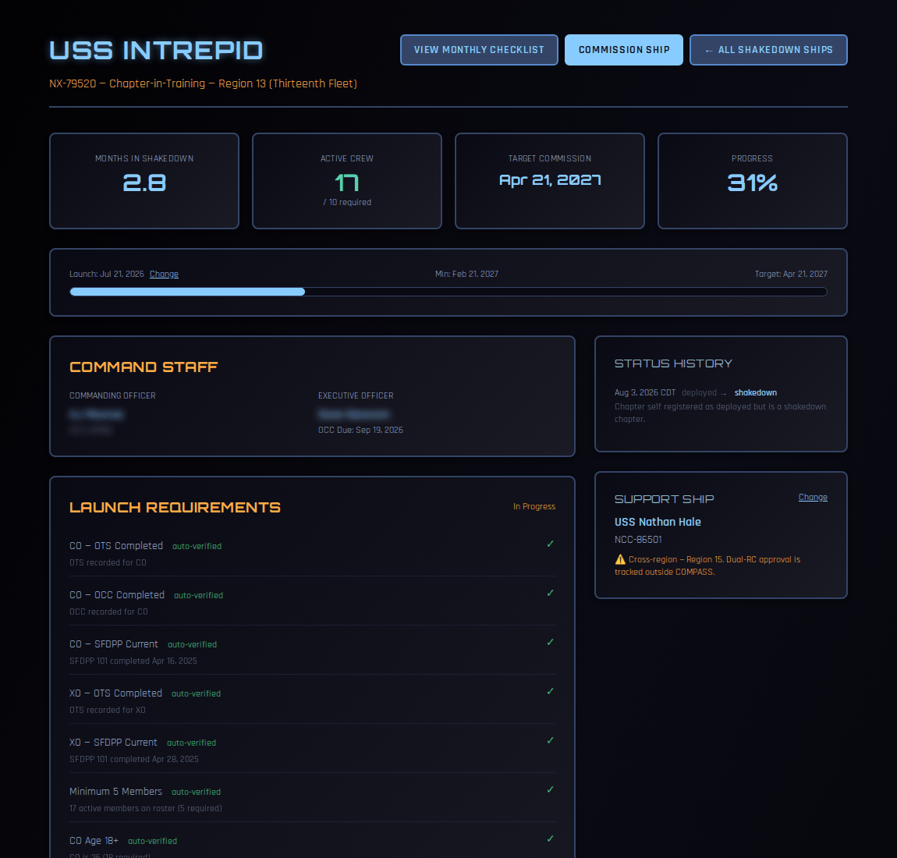

# Chapters-in-Training

The Chapters-in-Training board tracks every chapter in your region that is in shakedown: how far through it is, whether it's keeping up with monthly reporting, and whether it's ready to commission.

How chapters get onto the board, and how they leave it, is covered in [Ship Lifecycle](ship-lifecycle.md).

!!! note "About the screenshots"
    The screenshots on this page come from a test copy of COMPASS. Names are blurred.

---

## Who can see it

The RC, VRC and RSHOO, plus fleet shakedown officers. Fleet officers get a **Fleet view** selector to look at any region.

---

## The board

Go to **Regional Dashboard → Regional Actions → Chapters-in-Training**, or **Regional Reports → Chapters-in-Training**.

Each chapter in shakedown gets a card:

| Field | What it shows |
|---|---|
| **Progress** | How far through shakedown the chapter is, as a percentage and a bar. |
| **Month** | Which month of the 9-month START Manual it's in. |
| **Started** / **Target** | The launch date and the target commission date (earlier if the chapter qualified for the Accelerated Shakedown Program). |
| **Crew** | Active crew against the 10 needed to commission. |
| **Reporting** | How many of the monthly report items due so far are done and verified. Green at 100%, yellow from 75%, red below. |
| **XO OCC Due** | The XO's OCC deadline (60 days from launch). Red once it has passed. |

A red note under the bar flags anything outstanding, such as a monthly report item.

Each card has **View Checklist** and **Commission** buttons.

---

## A chapter's shakedown page

Click **View Checklist** to open a chapter's shakedown page.

- **Totals** — months in shakedown, active crew (out of 10), target commission date, and progress.
- **Timeline** — launch date (with **Change**), minimum commission date and target date.
- **Command Staff** — the CO and XO, with the XO's OCC due date (marked **OVERDUE** once it passes).
- **Launch Requirements** — what had to be in place at launch. Most are **auto-verified** by COMPASS; any that aren't can be marked done here.
- **Status History** and **Support Ship** (with **Change**).
- **Monthly Checklist** — see below.

---

## Verifying monthly reports

Each month of shakedown has a checklist from the STARFLEET START Manual. The chapter's command team marks items done as they complete them. Your job is to check and **verify** them.

Items can be verified by the RC or RSHOO for chapters in their region, and by the **support ship's command team** for the chapters they mentor. A chapter can never verify its own items.

1. Open the chapter's shakedown page and scroll to **Monthly Checklist**.
2. Open the current month (or an earlier one).
3. For each item the chapter has marked done, check it against what you've received, then verify it.

**A required reporting item only counts once it's both done and verified.** Those items feed the commission checklist, so an unverified month holds the chapter back even if the chapter did the work. The other items are acknowledgments that are simply tracked.

!!! tip
    Verify monthly items as reports come in rather than saving them up. A chapter that is up to date shows 100% **Reporting** on the board, and it's obvious at a glance which chapters need a nudge.

---

## When a chapter is ready

When the minimum period has passed, crew is at 10 or more, the XO has OCC, and reporting is complete, click **Commission** on the card. See [Commissioning a chapter](ship-lifecycle.md#commissioning-a-chapter).
