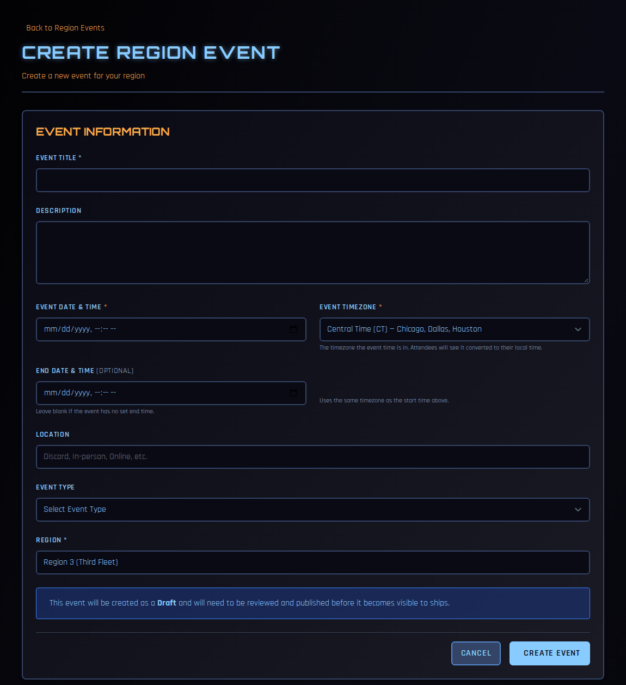
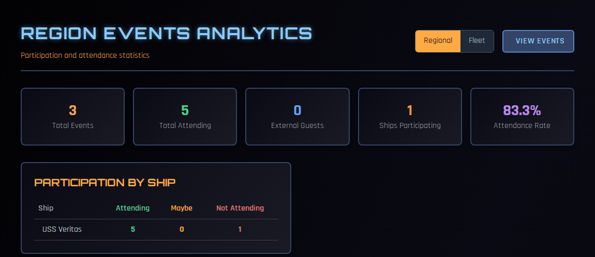

# Regional and Fleet Events

Regional events are events you run for the whole region: a summit, a regional convention table, a virtual game night. Chapters add your event to their own calendars, their crew RSVP and get attendance credit there, and you see the turnout across the region.

!!! note "About the screenshots"
    The screenshots on this page come from a test copy of COMPASS.

---

## Who can do what

| Task | Who |
|---|---|
| Create, edit, cancel and delete regional events | RC, VRC, RCOS, RCOO |
| See RSVPs for your region's events | RC, VRC, RCOS, RCOO |
| Add a regional or fleet event to a ship's calendar | CO, XO, OPS, SO |

Fleet-wide events work the same way, under the **Fleet Events** tab. They're created at fleet level by a COMPASS administrator.

---

## The Regional Events page

Go to **Events → Shared Regional/Fleet Events**, or **Regional Dashboard → Regional Actions → Regional Events**.

The page has three sets of controls:

- **Regional Events** / **Fleet Events** — which scope you're looking at.
- **Official** / **Shared by Chapters** — events created by regional or fleet staff, or events individual chapters have shared with the region. See [Sharing Events Between Chapters](../co-guide/event-sharing.md) for the chapter side.
- **Analytics** — participation statistics (see [below](#analytics)).

It lists upcoming events, plus any from the last 24 hours.

---

## Creating an event

1. Click **Create Region Event**.

    

2. Fill in the form:
    - **Event Title** and **Description**
    - **Event Date & Time**, and the **Event Timezone** that time is in. Each attendee sees it converted to their own time zone.
    - **End Date & Time** — optional; uses the same time zone.
    - **Location** — a place, or Discord, Online and so on.
    - **Event Type** — this sets the points chapters' crew earn for attending.
    - **Region** — your region.
3. Click **Create Event**.

**New events start as a Draft.** Chapters can't see a draft. When it's ready, open the event, click **Edit**, set the **Status** to **Published**, and save.

---

## How chapters take part

Once an event is published, it appears on every chapter's **Shared Regional/Fleet Events** page. A ship's CO, XO, OPS or SO adds it to their calendar, which creates a copy on that ship:

- the chapter's crew RSVP on their ship's copy;
- attendance is recorded on the copy, so the points go to their own record;
- you see the combined turnout on your event.

The event page shows **Expected Attendance** — how many people are attending across how many ships and regions. Chapters only share counts with you, never individual names.

---

## Seeing RSVPs

On the event page, click **View RSVPs**. You'll see:

- totals for **Attending**, **Maybe**, **Not Attending** and **Total Expected**, including any external attendees expected;
- **Participation by Ship** — each chapter's attending, maybe and not attending counts;
- **Individual Responses** for your region.

---

## Changing or cancelling an event

- **Edit** — change any detail, or its status.
- **Cancel Event** — opens a confirmation page showing which ships have the event on their calendar, how many confirmed attendees are affected, and the RSVP summary. Click **Cancel Event** to confirm. This sets the event to **Cancelled**, cancels it on every ship's calendar, and notifies everyone who RSVP'd. It can't be undone.
- **Delete** — removes an event entirely. Use Cancel instead for an event chapters have already added, so their crew are told.

---

## Analytics

Click **Analytics** on the Regional Events page for participation across your events.

- Switch between **Regional** and **Fleet**, and filter by region.
- **Totals** — total events, total attending, external guests, ships participating and attendance rate.
- **Participation by Ship** and **Participation by Region** — attending, maybe and not attending for each.
- **Recent Events** — each event with its attendance.

Use it to see which chapters turn out for regional events and which you might reach out to.
