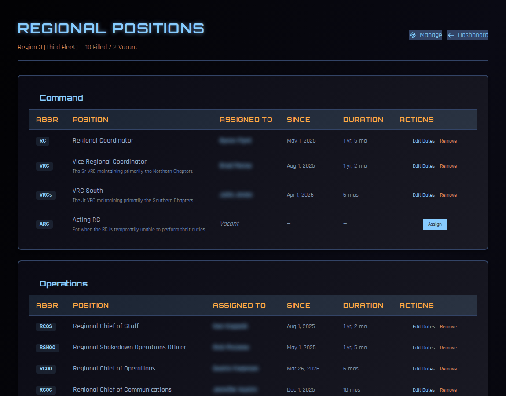
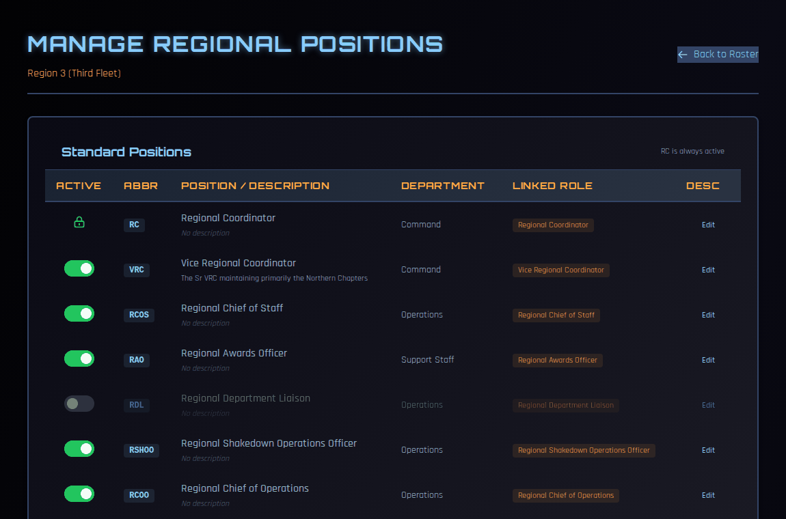

# Regional Positions

Regional positions record who holds each job on your regional staff — RC, VRC, Chief of Staff, Awards Officer and so on. Assigning someone a position also gives them the COMPASS access that goes with it.

!!! note "About the screenshots"
    The screenshots on this page come from a test copy of COMPASS. Names are blurred.

---

## Who can do what

| Task | Who |
|---|---|
| See your region's positions | Regional staff |
| Assign and remove holders, edit dates | RC, VRC |
| Add, switch on/off, edit or delete positions | RC, VRC |

---

## Your regional staff

Go to **Regional Dashboard → Regional Actions → Set Regional Positions**.

The heading shows how many positions are filled and how many are vacant. Positions are grouped by department, such as **Command** and **Operations**. Each row shows the abbreviation, the position, who holds it, since when, and for how long.

### Assigning someone

1. Click **Assign** on a vacant position, or on a position that allows more than one holder.
2. Search for the member and pick them.
3. Set the start date, then confirm.

### Changing or ending an assignment

- **Edit Dates** — correct when someone started (or ended) in the position.
- **Remove** — end their time in the position. Their history is kept, so they appear in the position's record and on their own crew record.

### What an assignment does

Assigning a position does more than fill in a name:

- **It grants the linked role.** Each position is linked to a COMPASS role — the RAO position grants the Regional Awards Officer role, and so on. The new holder gets that role's access straight away.
- **It awards leadership points.** Regional leadership positions count toward the member's permanent points under **Leadership Positions**.
- **Removing it takes the role away** — unless the member holds another position that grants the same role.

!!! tip
    Because positions grant access, keep them up to date. When someone steps down, **Remove** them on the day so their access ends too.

---

## Setting up positions

Click **Manage** at the top of the Regional Positions page.

### Standard positions

Every region has the same standard positions: RC, VRC, RCOS, RAO, RDL, RSHOO, RCOO, RCOC and the others. You can't delete these, but you can:

- switch a position **off** if your region doesn't use it (the RC position is always on);
- **Edit** its description, for example to explain how your region divides the VRC role between north and south.

### Custom positions

Under **Custom Positions**, click **Add Custom Position** to create a job your region needs that isn't in the standard list, such as a second VRC or an Acting RC.

- **Position Name** and **Abbreviation**
- **Department** — the group it appears under
- **Linked Role** — the COMPASS role holders receive, or **None** for a title with no extra access
- **Max Holders** — how many people can hold it at once
- **Description**

Custom positions can be switched on and off, edited, and deleted.

!!! warning
    Choose the **Linked Role** carefully. Linking a custom position to a role gives everyone you assign to it that role's full access.
