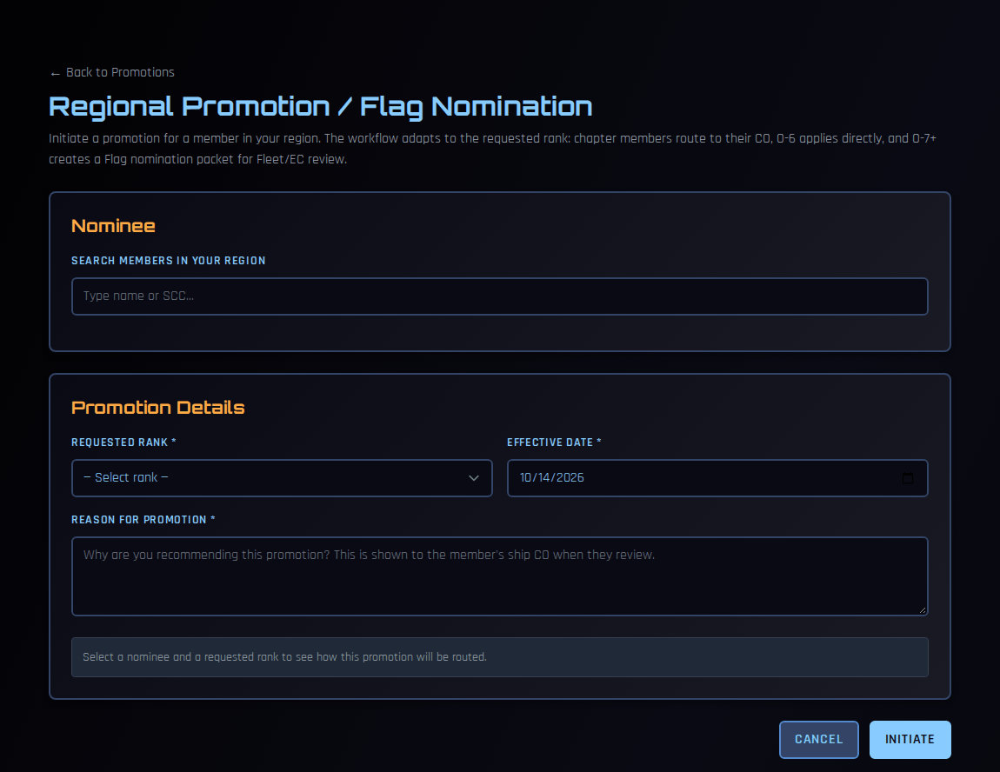
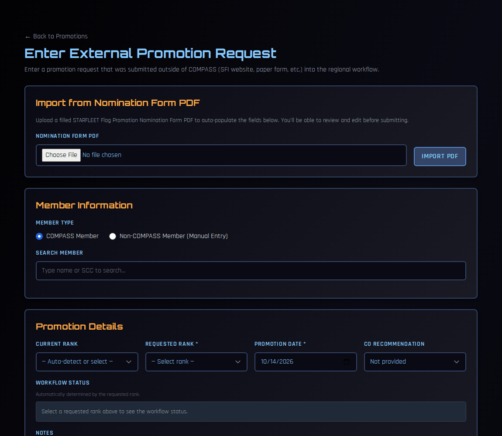

# Promotions (RC)

As RC, you are the approving authority for all promotion submissions from ships in your region. This page covers the full regional review workflow for both standard and flag officer promotions.

---

## How Submissions Reach You

When a CO submits a promotion in COMPASS, the member's row on their Promotion Eligibility Report changes to show **Submitted for Approval** with a **Pending** badge. The submission simultaneously appears in your Regional Promotions queue.

 - Workflow 2c.png)

---

## The Regional Promotions Page

Go to **Regional Promotions** in the left navigation (visible only with an RC-level role) to see all pending submissions across your region.

 - Workflow 2d.png)

The page is divided into three sections:

| Section | Contents |
|---|---|
| **O6 & Below Pending Approval** | Promotions awaiting your direct approval: Captain promotions from ships, and unassigned members' own requests ([see Approving Unassigned Member Promotions](unassigned-promotions.md)) |
| **O-7+ Pending Recommendation** | Fleet Captain and above awaiting your recommendation to SFI Fleet Command |
| **Recently Actioned** | All promotions you've recently approved, rejected, or forwarded — with current status |

Each row shows the member, ship, from/to rank, submitted by, submitted date, CO Recommendation status, and a **Review** button.

---

## Reviewing an O-6 Promotion (Captain)

Click **Review** on any O-6 submission to open the review panel.

 - Workflow 2e.png)

The panel shows:

- **Member and ship details** — name, ship, from/to rank, points, promotion date, submitted by
- **CO Recommendation** — green badge if the CO recommends approval
- **Nomination Form Answers** — the CO's narrative responses to all promotion questions

You can edit individual answers inline by clicking **Edit** on any question before approving — useful for correcting typos or clarifying answers before the record is finalised.

 - Workflow 2f.png)

### Approving

Click **Approve Promotion**. The member's rank updates in COMPASS immediately and they receive an email notification. The promotion moves to **Recently Actioned** with an **Approved** status badge.

### Rejecting

Click **Reject Promotion** and provide a reason. The CO receives the rejection with your reason. The promotion is removed from the queue and the CO can correct and resubmit.

---

## Reviewing an O-7+ Promotion (Fleet Captain and above)

O-7+ promotions cannot be approved at the regional level — your role is to review, endorse, and forward to SFI Fleet Command. Click **Review** on any O-7+ submission.

 - Workflow 3a.png)

Review the full submission including all nomination form answers. Edit any answers inline if needed.

 - Workflow 3b.png)

You have three options:

| Button | Action |
|---|---|
| **Recommend to Fleet** | Forwards the nomination to SFI Fleet Command with optional endorsement notes |
| **Nomination Form** | Downloads the pre-filled Flag Promotion Nomination Form PDF |
| **Reject** | Rejects at the regional level — CO is notified with your reason |

### Downloading the Nomination Form PDF

Before forwarding, download and review the generated PDF using the **Nomination Form** button. COMPASS pre-fills the entire form from data already in the system.

 - Workflow 3b - Form.png)

The PDF includes nominee details, current/requested rank, all positions held since last rank date, OTS/OCC/SFDPP completion dates, and the CO's narrative recommendation answers. Review it carefully — this is the document SFI Membership Services receives.

### Recommending to Fleet

Click **Recommend to Fleet**. A confirmation dialog appears where you can add optional notes to Fleet Command.

 - Workflow 3c.png)

Click **Recommend to Fleet** to confirm. COMPASS returns to the Regional Promotions page with a confirmation banner.

### After Recommending — Awaiting Fleet Decision

After forwarding, the promotion moves to the **Recently Actioned** table with a status of **Awaiting Fleet Decision**. Two action buttons remain available.

 - Workflow 3d.png)

!!! note
    The external approval process now continues outside COMPASS. SFI Fleet Command will review the nomination and respond to you directly. Submit the PDF to SFI Membership Services per the standard process if you haven't already.

### Recording the Fleet Decision

When SFI Fleet Command responds, return to the Regional Promotions page and click **Record Fleet Decision** on the promotion row.

 - Workflow 3e.png)

Select **Approved** or **Rejected**, add any notes from Fleet Command, and click **Submit Decision**.

If approved, the member's rank updates in COMPASS immediately and they receive an email notification. The promotion status changes to **Approved** in the Recently Actioned table.

 - Workflow 3f.png)

---

## Initiating a Promotion

You don't have to wait for a CO to submit. The RC, VRC and RCOS can put a member forward themselves — for example, to recognise regional service, or to start a Flag nomination.

1. On the Regional Promotions page, click **+ Initiate Promotion / Flag Nomination**.

    

2. Under **Nominee**, search for the member by name or SCC. You can choose anyone in your region, including unassigned members.
3. Choose the **Requested Rank** and **Effective Date**, and give the **Reason for Promotion**. The reason is shown to the member's CO if the promotion goes to them.
4. Read the routing note COMPASS shows once you've chosen a nominee and rank, and the advisory **Eligibility** check (points, time in grade, course prerequisites).
5. Fill in what the route asks for (below), and optionally the **Nomination Form Questions**.
6. Click **Initiate**.

### How it's routed

COMPASS picks the route from the requested rank and the member's situation:

| Promotion | What happens |
|---|---|
| **O-5 and below**, chapter member | Goes to the member's **CO** to confirm the chapter requirements (points, time in grade) and approve or decline. |
| **O-5 and below**, member is their chapter's CO | Skips the CO step — there's no one above them in the chapter — and you apply it directly. |
| **O-5 and below**, unassigned member | You apply it directly. |
| **O-6** (Captain/Colonel) | You apply it directly. The CO's input is optional and advisory; a CO can't veto it. |
| **O-7 and above** | Creates a **Flag nomination packet** for Fleet/EC review. The rank doesn't change until Fleet decides. An **RC Recommendation Letter** is required. |

For O-6 and Flag nominations you can tick **Chapter CO Input (Advisory)** to ask the member's CO for examples of their chapter accomplishments (Question 3 of the nomination form). It's advisory only: you can apply or submit at any time, and doing so withdraws the request.

You can't initiate a promotion for yourself, or for a member outside your region.

---

## Entering an External Promotion

Some promotion requests arrive outside COMPASS — through the SFI website, on a paper form, or from a chapter that doesn't use COMPASS. Enter them so they go through the same regional workflow and are tracked with everything else.

The RC, VRC, RCOS, RCOO and RAO can enter them.

1. On the Regional Promotions page, click **+ Enter External Request**.

    

2. **Optional:** if you have a filled-in STARFLEET Flag Promotion Nomination Form PDF, choose it under **Import from Nomination Form PDF** and click **Import PDF**. COMPASS fills in the form from it and shows you everything it extracted. Check every field before going on.
3. Under **Member Information**, choose:
    - **COMPASS Member** — search by name or SCC; or
    - **Non-COMPASS Member (Manual Entry)** — type their full name, SCC, email, chapter and region.
4. Under **Promotion Details**, set the current rank (or let COMPASS detect it), the **Requested Rank**, the **Promotion Date**, and the **CO Recommendation** if there is one (**Recommends Approval** or **Not Recommended**). Add notes and any nomination-form details you have.
5. Submit.

The **Workflow Status** is set from the requested rank: O-6 and below land in your queue as **Pending RC Approval**; O-7 and above as **Pending RC Recommendation**. From there, review them like any other submission.

---

## Promotion Workflow Tips

- Check **Attention Required** on your [Regional Dashboard](regional-dashboard.md) daily — its **Pending Promotions** tile counts every O-6+ promotion waiting for you across all ships
- Make sure OTS/OCC data is current before you decide. Open the member's record (Regional Dashboard → the ship's **Roster** → the member) and click **Sync SFI Data**, or ask the CO to run a full [SFI Eligibility Sync](sfi-eligibility-sync.md) for the ship
- Download and review the Flag Promotion PDF before forwarding to Fleet — easier to catch data issues in the PDF view than in the form
- Edit nomination narrative answers inline before approving if the CO's responses are vague — stronger narratives mean faster SFI processing
- For O-7+ promotions, record the Fleet decision in COMPASS as soon as you hear back — it keeps your Recently Actioned table accurate and notifies the member promptly
