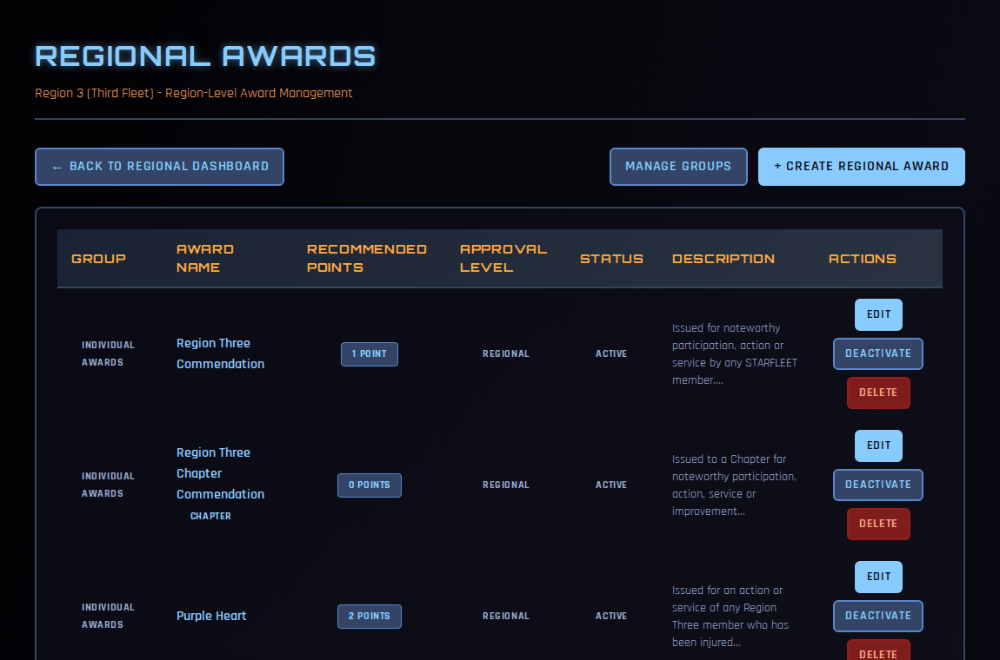
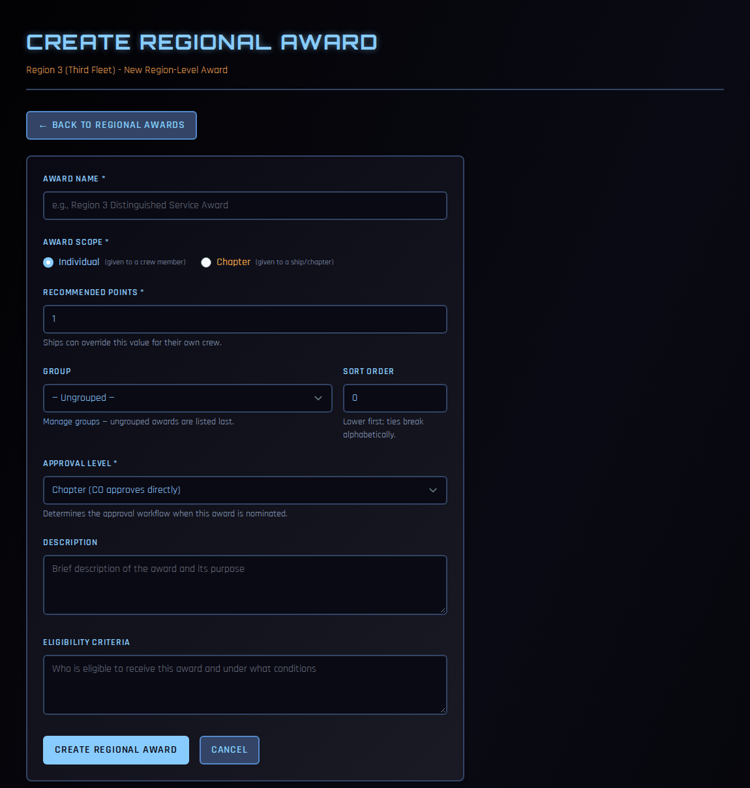

# Creating Regional Awards

Regional awards are your region's own commendations — a Region Commendation, a Purple Heart, a chapter-of-the-year award. Once you create one, every chapter in your region can nominate crew (or chapters) for it.

This page covers setting awards up. Reviewing the nominations that come in is covered in [Awards (RC)](awards.md).

!!! note "About the screenshots"
    The screenshots on this page come from a test copy of COMPASS.

---

## Who can do what

| Task | Who |
|---|---|
| Create regional awards and award groups | RC, VRC, RAO, RCOS, RCOO |
| Edit awards and groups | RC, VRC, RAO |
| Deactivate, delete, or delete groups | RC, VRC, RAO |

---

## Your regional awards

Go to **Regional Dashboard → Regional Actions → Manage Regional Awards**.

Each award shows its group, name, recommended points, approval level, status and description. From here you can **Edit**, **Deactivate** or **Delete** an award.

---

## Creating an award

1. Click **+ Create Regional Award**.

    

2. Fill in the form:
    - **Award Name**
    - **Award Scope** — **Individual** (given to a crew member) or **Chapter** (given to a ship).
    - **Recommended Points** — the promotion points the award is worth. Ships can override this value for their own crew.
    - **Group** and **Sort Order** — where it appears in award lists (see [Award groups](#award-groups)). Lower sort orders come first.
    - **Approval Level**:
        - **Chapter** — the CO approves nominations directly. Use this for awards chapters can give on their own judgement.
        - **Regional** — the CO recommends, then the RAO or RC approves. Use this for awards the region wants to decide.
    - **Description** and **Eligibility Criteria** — what the award is for and who qualifies. Chapters see this when nominating, so be specific.
3. Click **Create Regional Award**.

The award is active straight away, and chapters in your region can nominate for it.

---

## Changing an award

- **Edit** — change any of the fields above.
- **Deactivate** — retires the award. Nobody can be nominated for it any more, but everyone who has received it keeps it. You can reactivate it later.
- **Delete** — removes the award permanently. You can't delete an award with pending nominations; deactivate it instead. Members who have already received it keep the award on their record.

!!! tip
    Prefer **Deactivate** over **Delete**. It keeps the award's history intact and can be undone.

---

## Award groups

Groups organise your awards into sections, such as **Individual Awards** and **Chapter Awards**. Click **Manage Groups** on the Regional Awards page.

- **Add Group** — enter a name and an order.
- Use the ▲ and ▼ arrows to reorder groups.
- Rename a group and click **Save**.
- Switch a group **Active** or **Inactive**.
- **Delete** a group — its awards become ungrouped; they aren't deleted.

Groups appear in the order you set. Within a group, awards sort by their own sort order, then alphabetically. Ungrouped awards are listed after all groups.

Groups belong to your region. Ships keep their own groups separately, and groups aren't shared between regions.
