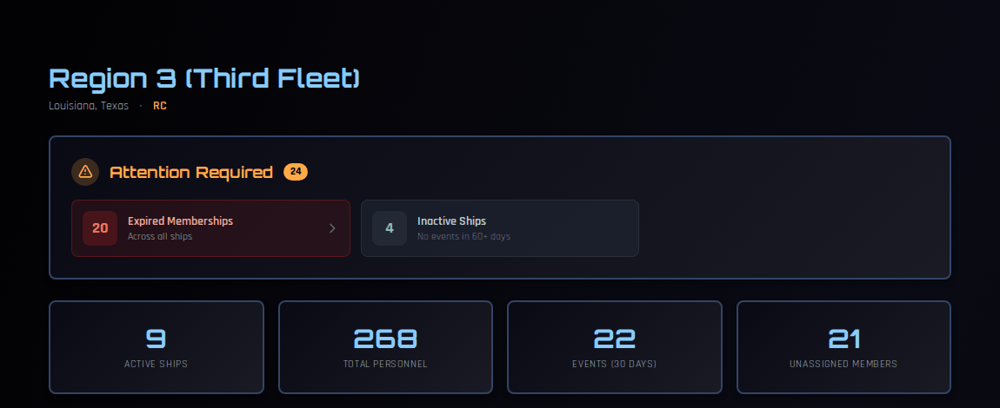
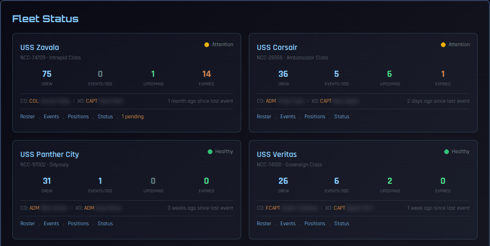
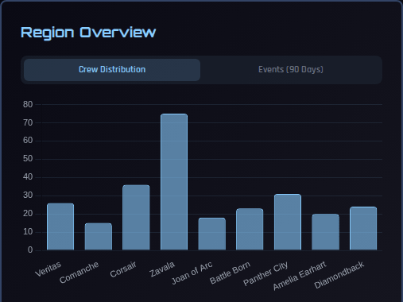
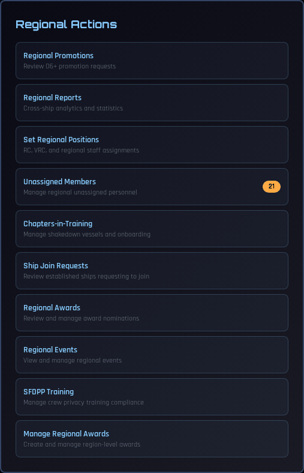
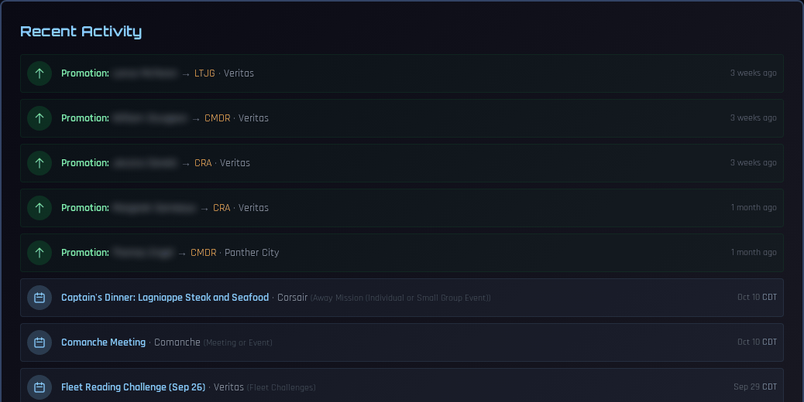

# Regional Dashboard

The Regional Dashboard is your view of every chapter in your region: what needs your attention, how each ship is doing, and shortcuts to the regional tools.

Go to **Regional Dashboard** under **Dashboards** in the left navigation. It appears for regional staff (RC, VRC, RCOS, RCOO, RAO and RCOC) and for fleet officers who oversee regions.

!!! note "About the screenshots"
    The screenshots on this page come from a test copy of COMPASS. Member names are blurred.

---

## Header and Summary

The top of the page shows your region's name, the states it covers, and your regional role.

!!! tip "Fleet officers"
    If your role covers more than one region, a **region selector** appears beside the heading. Pick a region to switch the whole dashboard to it.

### Attention Required

This panel appears only when something needs action, with a badge showing the total count. Each tile links to where you deal with it:

| Tile | What it means |
|---|---|
| **Pending Promotions** | O-6 and above promotions waiting for RC action. Opens [Regional Promotions](promotions.md). |
| **Ship Join Requests** | Established chapters asking to join COMPASS. |
| **Award Nominations** | Nominations waiting for regional action. See [Awards](awards.md). |
| **Annual Award Nominations** | Annual award nominations waiting for your regional selection. |
| **Expired Memberships** | Crew across your region whose SFI membership has expired. Opens the regional crew report. |
| **Inactive Ships** | Operating ships with no events in the last 60 days. |

While an Annual Awards cycle is open, a **Nominations Open** notice also appears here, with the fleet's target date.

### Summary bar

Four totals for the region:

- **Active Ships** — chapters that are operating, including chapters-in-training (shakedown)
- **Total Personnel** — active crew on those ships. Crew of chapters-in-training are not counted here, even though their ships are counted under Active Ships.
- **Events (30 Days)** — events held in the last 30 days
- **Unassigned Members** — members in your region with no ship. Click it to open the unassigned members dashboard. A "+ *n* pending ship" line counts unassigned members attached to a ship that is still being set up in COMPASS.

---

## Fleet Status

Every active ship in your region gets a card, largest crew first. Each card shows:

- **Crew**, **Events/30d**, **Upcoming** events, and **Expired** memberships
- The **CO** and **XO** (or "Vacant"), and how long it has been since the ship's last event
- Links to that ship's **Roster**, **Events** and **Positions**, plus **Status** if you can manage ship status
- A **pending** count if the ship has events waiting for approval

### Health indicator

The coloured dot in each card's corner is a quick health check. COMPASS counts three warning signs:

1. One or more crew have an **expired membership**
2. **No events in the last 60 days** (or no events at all)
3. **Fewer than 5 active crew**

| Indicator | Warning signs |
|---|---|
| 🟢 **Healthy** | None |
| 🟡 **Attention** | One |
| 🔴 **Critical** | Two or more |

The indicator is a prompt for a conversation with the CO, not a judgement. A small chapter that meets regularly can show "Attention" simply because it has fewer than five members.

### Non-Operational Ships

Ships that are dry-docked, in reserve, decommissioned or otherwise not operating don't get a card. If your region has any, a **Non-Operational Ships** button appears below Fleet Status with a count. It opens a list of those ships and their status, with a **Manage Status** link for officers who can change it.

---

## Region Overview

A chart with two tabs:

- **Crew Distribution** — active crew on each ship
- **Events (90 Days)** — events each ship has held in the last 90 days

---

## Regional Actions

Shortcuts to the regional tools. Which ones you see depends on your role.

| Link | Use it to |
|---|---|
| **Regional Promotions** | Review O-6 and above promotion requests. See [Promotions (RC)](promotions.md). |
| **Regional Reports** | Run cross-ship reports for the region. |
| **Set Regional Positions** | Assign the RC, VRC and regional staff positions. |
| **Unassigned Members** | Manage members in your region with no ship. See [Unassigned Member Promotions](unassigned-promotions.md). |
| **Chapters-in-Training** | Manage shakedown chapters and onboarding. |
| **Ship Join Requests** | Review established ships asking to join COMPASS. |
| **Regional Awards** | Review award nominations. See [Awards (RC)](awards.md). |
| **Regional Events** | View and manage regional events. |
| **SFDPP Training** | Track crew privacy training compliance. |
| **Manage Regional Awards** | Create and manage awards specific to your region. |

A badge on a link shows how many items are waiting there.

---

## Regional Announcements

Active announcements for your region are listed here. Officers who can post announcements see a **Manage Announcements** button to create or edit them.

---

## Recent Activity

The five most recent promotions in your region, followed by the eight most recent events, with the ship each belongs to.

---

## If You're Also a CO

When you hold both a ship role (CO or XO) and a regional role, the left navigation shows both **Command Dashboard** and **Regional Dashboard**:

- **Command Dashboard** — your own ship only
- **Regional Dashboard** — every ship in your region

You can move between them freely.
