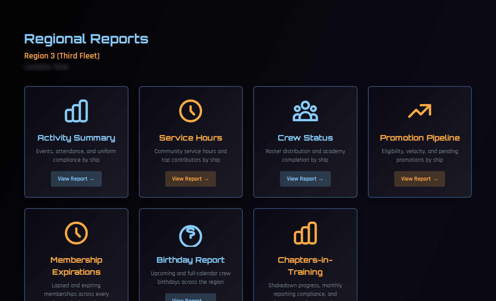
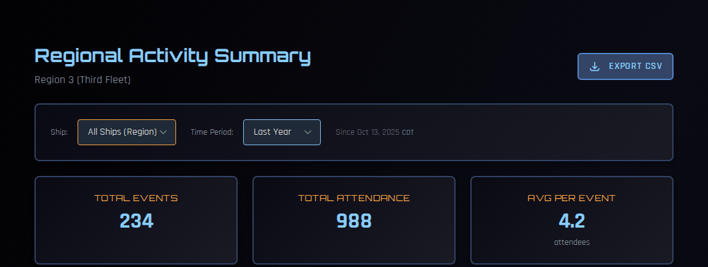
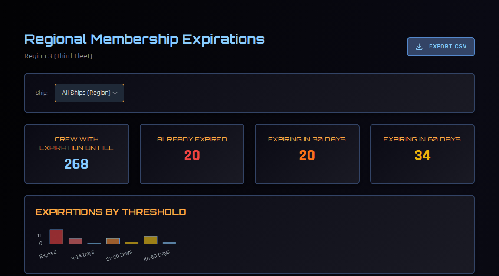

# Regional Reports

Regional reports pull together figures from every chapter in your region. Each one can be narrowed to a single ship, and four of them export to CSV for spreadsheets or your own reporting.

!!! note "About the screenshots"
    The screenshots on this page come from a test copy of COMPASS.

---

## Who can see them

| Task | Who |
|---|---|
| View regional reports | RC, VRC, RCOS, RCOO, RAO, RCOC, RSHOO, RDL and RSS |
| Export to CSV | RC, VRC, RCOS, RCOO and RAO |

Every report covers **your own region**. Fleet officers who oversee several regions can choose which region to view.

---

## Opening the reports

Go to **Regional Dashboard → Regional Actions → Regional Reports**.

Every report has a **Ship** filter at the top. Leave it on **All Ships (Region)** for the whole region, or pick one chapter. Where a report has an **Export CSV** button, the export uses the same filters you've chosen.

---

## Activity Summary

Events, attendance and uniform compliance across the region.

- **Time Period** — the last 30 days, 3 months, 6 months, year, 5 years, or all time.
- **Totals** — total events, total attendance, and average attendance per event.
- **Charts** — events by type, attendance by event type, an event timeline, and events by ship.
- **Most Attended Events** — ranked by the percentage of each ship's crew who attended, so a small chapter's well-attended meeting ranks fairly against a large chapter's.
- **Event Type Details** — how many of each event type, and their average attendance.

**Export CSV** downloads the region's totals for the period, then one row per chapter: events, total attendance, average attendance and uniform compliance.

## Service Hours

Community-service hours logged by your chapters.

- **Time Period** — the same choices as the Activity Summary.
- **Charts** — total hours by ship, hours by service type, and a timeline.
- **Top Volunteers** — the members with the most hours, with their ship and event count.
- **Recent Service Events** — each event with its hours, participants and location.
- **Ship Statistics** — total hours, contributors and events for each ship.

**Export CSV** downloads one row per chapter for the period: total hours, contributors, events, active crew and average hours per member.

## Crew Status

The make-up of your region's crew.

- **Totals** — total personnel, active ships, officers, enlisted and cadets.
- **Crew Distribution by Ship** — a chart of crew per chapter.
- **Ship Statistics** — for each ship: personnel, officers, enlisted, cadets, and **OTS** and **OCC** completion rates. OTS is green at 75% and above, yellow from 50%; OCC is green at 50% and above, yellow from 25%.

## Promotion Pipeline

How promotions are moving through the region.

- **Totals** — pending promotions, promotions in the last 90 days, and average days in rank.
- **Pending Promotions by Ship** — a chart.
- **Ship Statistics** — for each ship: pending promotions, promotions in the last 90 days, average time in rank, and **promotion velocity** (promotions per month).

## Membership Expirations

Lapsed and soon-to-lapse SFI memberships across every chapter.

- **Totals** — crew with an expiration date on file, already expired, and expiring in the next 30 and 60 days.
- **Expirations by Threshold** — a chart grouping members from expired through 60 days out.
- **Expirations by Ship** — each chapter's expired count, percentage expired, and expiring in the next 30 days, sorted with the chapters carrying the most lapsed memberships at the top.
- **Member lists** — each member's SCC, name, rank, position, ship, expiration date and days remaining (or days since it lapsed).

**Export CSV** downloads the member list for the ship you've selected. Use it to plan renewal reminders with your COs.

## Birthday Report

Upcoming crew birthdays across the region, for cards, shout-outs or newsletters.

- **Totals** — crew with a birthday on file, birthdays today, this week (0–7 days) and this month (0–30 days).
- **Charts** — birthdays by month and by ship.
- **Lists** — today's birthdays and the week ahead, with each member's ship and the age they're turning.

**Export CSV** downloads the birthday list for the ship you've selected.

!!! warning "Personal information"
    The expirations and birthday exports contain members' names, SCCs and dates. Keep them to regional business, and don't post them anywhere public.

---

## Chapters-in-Training

The Reports page also links to the **Chapters-in-Training** board, which tracks shakedown progress and monthly reporting. See [Chapters-in-Training](chapters-in-training.md).
