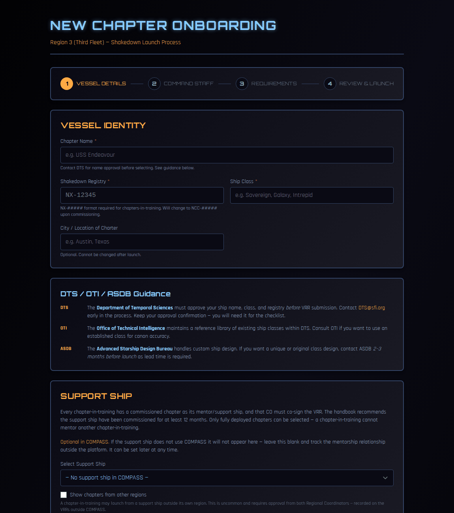
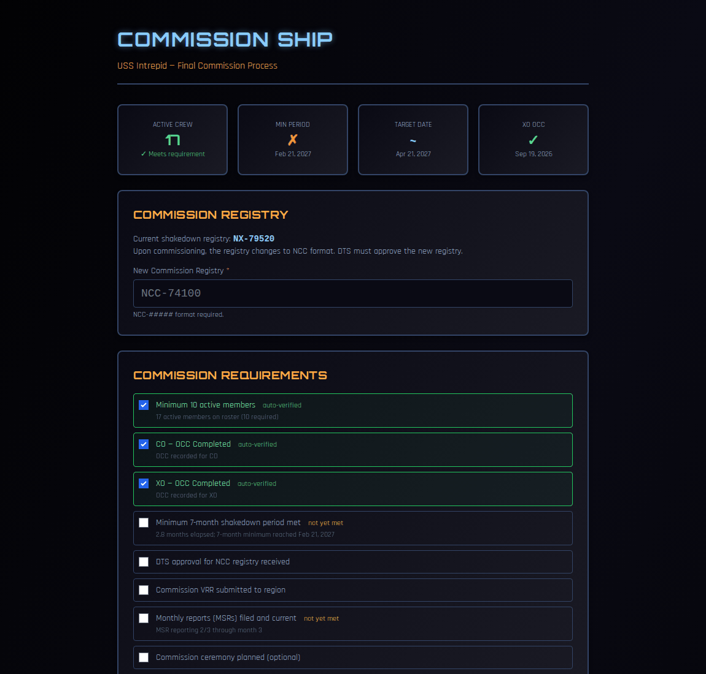
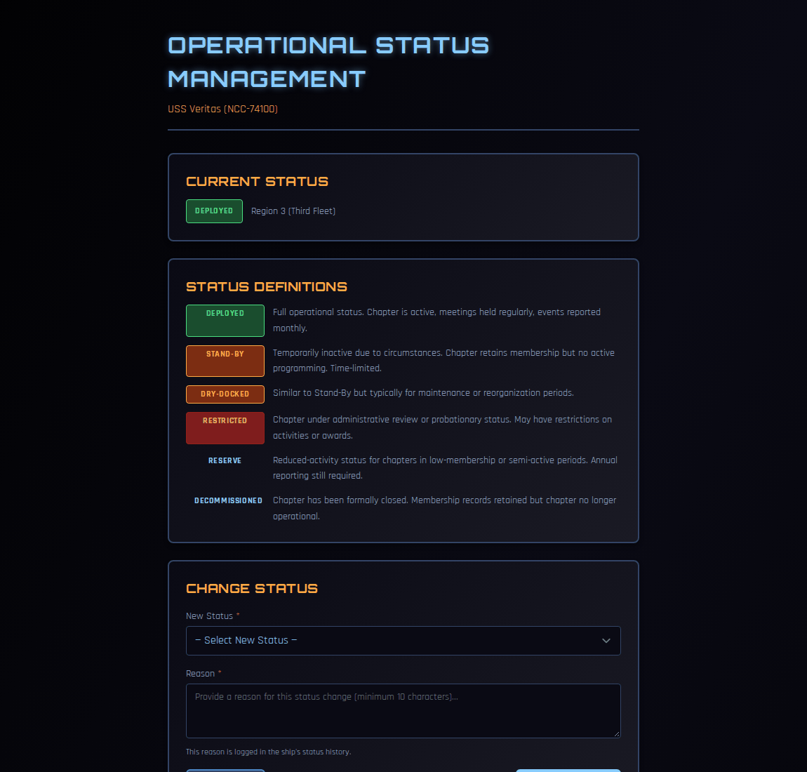

# Ship Lifecycle

This page covers a chapter's life in COMPASS from the regional side: launching a new chapter-in-training, guiding it through shakedown, commissioning it, and changing a chapter's status later on.

Day-to-day tracking of chapters in shakedown is on the [Chapters-in-Training](chapters-in-training.md) board.

!!! note "About the screenshots"
    The screenshots on this page come from a test copy of COMPASS. Names are blurred.

---

## Who can do what

| Task | Who |
|---|---|
| Onboard a new chapter-in-training | RC, RSHOO |
| Change a launch date or support ship; convert a chapter to shakedown | RC, VRC, RSHOO |
| Commission a chapter | RC |
| Change a chapter's operational status | RC, VRC, RCOS, RCOO |

---

## The stages

| Stage | Registry | What it means |
|---|---|---|
| **Shakedown** (chapter-in-training) | NX-##### | A new chapter working through the START Manual, normally for 9 months, with a commissioned support ship as mentor. |
| **Deployed** | NCC-##### | A commissioned, fully operating chapter. |
| **Stand-By, Dry-Docked, Restricted, Reserve** | NCC-##### | Commissioned chapters in a reduced or limited state. See [Operational status](#operational-status). |
| **Decommissioned** | — | Formally closed. |

---

## Onboarding a new chapter-in-training

Go to **Chapters-in-Training → + Onboard New Chapter** (from the Regional Dashboard's **Chapters-in-Training** action).

The wizard has four steps.

### 1. Vessel Details

- **Chapter Name**, **Shakedown Registry** (NX-##### format) and **Ship Class**.
- **City / Location of Charter** — optional, and it can't be changed after launch.
- **Support Ship** — the commissioned chapter mentoring this one. Its CO co-signs the VRR, and the handbook recommends it has been commissioned for at least 12 months; COMPASS warns you if it hasn't. Only fully deployed chapters can be chosen.
    - If the support ship isn't on COMPASS, leave this blank and track the mentorship outside COMPASS. You can set it later.
    - Tick **Show chapters from other regions** for a support ship in another region. That's uncommon and needs both Regional Coordinators' approval on the VRRs.

The page also reminds you which offices to involve: **DTS** must approve the name, class and registry before the VRR; **OTI** can advise on established ship classes; **ASDB** handles original designs and needs 2–3 months' notice.

### 2. Command Staff

Search for the members who will be **CO** and **XO**, and pick each one. Both must be current STARFLEET members, and the search results show each person's SFDPP status.

### 3. Requirements

COMPASS checks each officer against the launch requirements:

- **CO** — OTS, OCC and current SFDPP completed.
- **XO** — OTS and current SFDPP completed. OCC isn't required before launch; the XO has **60 days** from launch to complete it, and COMPASS tracks the deadline.
- Both officers are **18 or older**.

Then complete the administrative items:

- **DTS Approval** — record the approval reference (email date, ticket number and so on).
- **Accelerated Shakedown Program (ASP)** — tick each ASP criterion the chapter meets. Standard shakedown is **9 months**. Each criterion takes **1 week** off, up to 8 weeks, but shakedown is never shorter than **7 months**.
- **RC Notes** — anything you want on record.

### 4. Review & Launch

Check the summary: vessel, command staff, support ship, shakedown timeline (launch date, XO OCC due date, minimum commission date) and checklist. Unchecked items are listed. You can still launch, but resolve them before the chapter's first monthly report.

Tick the confirmation and click **🚀 Launch Chapter-in-Training**.

Launching:

- creates the ship in **Shakedown** status and starts its timeline;
- makes your chosen officers its CO and XO;
- sends them a COMPASS welcome email if they don't have an account yet;
- tells the other regional officers who look after shakedown.

The new CO then imports the chapter's roster as usual. See [Getting Started](../co-guide/getting-started.md).

---

## Converting a chapter to shakedown

A chapter that joined COMPASS on its own is set to **Deployed**. If it's actually a chapter-in-training, convert it:

1. Open the ship's **Status** page (from its Fleet Status card on the Regional Dashboard).
2. Under **Chapter-in-Training**, click **Convert to Chapter-in-Training**.
3. Set the **Launch Date** (it defaults to today), optionally a **Support Ship**, and a **Reason**.
4. Tick the confirmation and click **Convert to Chapter-in-Training**.

The chapter keeps its crew, roles, registry and history. It gains the monthly START Manual checklist, a launch date and a support ship, and its commissioned date is cleared.

---

## Changing the launch date

The launch date drives which monthly checklist windows are open, and the minimum and target commission dates.

1. On the chapter's shakedown page, click **Change** next to **Launch**.
2. Pick the **New Launch Date** and give a **Reason for Change**.
3. Click **Save Launch Date**.

Changing it shifts which checklist months are open. The old and new dates are recorded.

---

## Changing the support ship

1. On the chapter's shakedown page, click **Change** next to **Support Ship**.
2. Choose the **New Support Ship**, or **None / not in COMPASS**.
3. Give a **Reason for Change** and click **Save Support Ship**.

The same rules apply as at launch: only deployed chapters can be chosen, a cross-region support ship needs both RCs' approval, and COMPASS warns if the ship has been commissioned for less than 12 months — that needs a waiver from the RC and the Chief of ShOC.

---

## Commissioning a chapter

When a chapter-in-training has completed shakedown, open it on the Chapters-in-Training board and click **Commission Ship**.

The top of the page checks the essentials: **Active Crew** (10 required), **Min Period** (7 months — the ASP can't shorten it further), the **Target Date**, and the **XO OCC**.

1. Enter the **New Commission Registry** in NCC-##### format. DTS must approve it.
2. Work through **Commission Requirements**. Some are **auto-verified** by COMPASS (crew count, CO and XO OCC, the minimum period, monthly reporting); tick the rest yourself (DTS approval of the NCC registry, the commission VRR submitted to the region, and so on).
3. Add any **Commission Notes**.
4. Click **Commission Ship** and confirm.

The chapter becomes **Deployed** with its new NCC registry. This can't be undone.

!!! warning "Commissioning early"
    If the minimum 7-month shakedown period hasn't passed, COMPASS shows the earliest commission date. Commissioning before it needs a waiver from the RC and the Chief of ShOC.

---

## Operational status

Open a ship's **Status** page from its Fleet Status card on the Regional Dashboard.

| Status | Meaning |
|---|---|
| **Deployed** | Fully operational: meetings held regularly, events reported monthly. |
| **Stand-By** | Temporarily inactive. Keeps its membership but no active programming. Time-limited. |
| **Dry-Docked** | Like Stand-By, usually for maintenance or reorganisation. |
| **Restricted** | Under administrative review or probation. Activities or awards may be restricted. |
| **Reserve** | Reduced activity in low-membership or semi-active periods. Annual reporting still required. |
| **Decommissioned** | Formally closed. |

To change it:

1. Choose the **New Status**.
2. Enter a **Reason** (at least 10 characters). It's recorded in the ship's **Status History** at the bottom of the page.
3. Click **Update Status**.

!!! danger "Decommissioning"
    Decommissioning moves every active crew member to unassigned status, closes all ship and department assignments, and removes ship roles. Member records — rank, awards, academy, service history — are kept. It affects the whole crew and can't easily be undone.

Stand-By and Restricted chapters still count as operating and keep their Fleet Status card on the Regional Dashboard. Dry-Docked, Reserve and Decommissioned chapters move to **Non-Operational Ships**.
