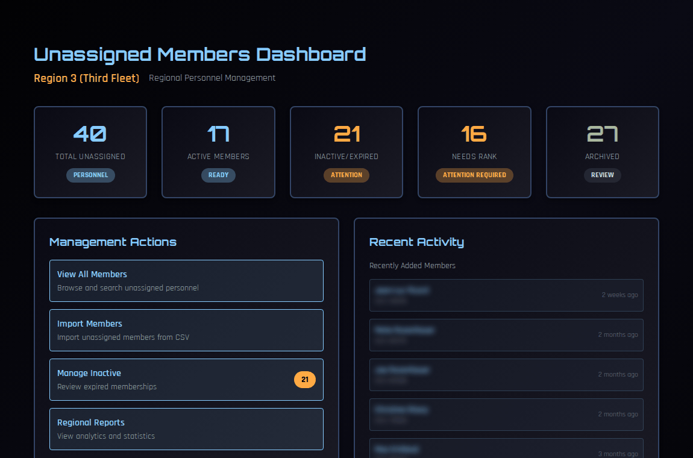
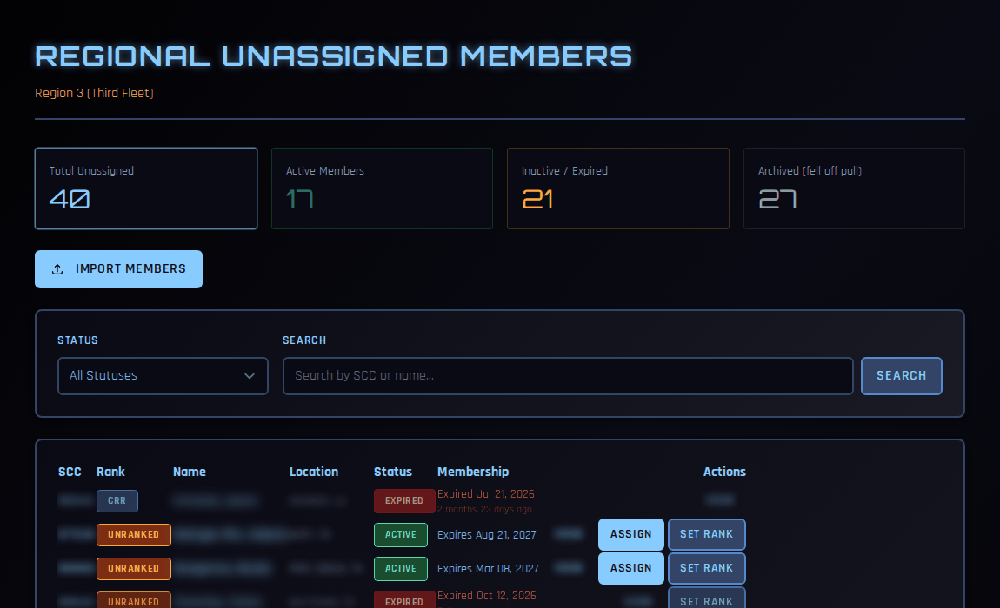

# Managing Unassigned Members

Unassigned members are STARFLEET members in your region who don't belong to a chapter. With no CO to look after them, the region does: you keep their records current, recognise them with awards, approve their promotions, and help them find a ship.

!!! note "About the screenshots"
    The screenshots on this page come from a test copy of COMPASS. Names and SCCs are blurred.

---

## Who can do what

| Task | Who |
|---|---|
| See unassigned members | RC, VRC, RCOS, RCOO, RAO |
| Import from db.sfi.org, edit details, update academy records | RC, VRC, RCOS, RCOO |
| Nominate for an award | RC, VRC, RCOS, RCOO, RAO |
| Approve promotions (Set Rank) | RC, VRC |
| Place a member on a ship (Direct Transfer) | RC, VRC, RCOS, RCOO |

---

## The dashboard

Go to **Regional Dashboard → Regional Actions → Unassigned Members**, or click **Unassigned Members** in the summary bar.

| Card | Meaning |
|---|---|
| **Total Unassigned** | Everyone on your region's unassigned list. |
| **Active Members** | Unassigned members with a current SFI membership. |
| **Inactive/Expired** | Members whose membership has lapsed. |
| **Needs Rank** | Members COMPASS has no rank for. Set one (see [Setting a rank](#setting-a-rank-or-approving-a-promotion)). |
| **Archived** | Members who have dropped off db.sfi.org's unassigned list (see [Importing](#keeping-the-list-current)). |

**Management Actions** link to the full list, importing, inactive members and regional reports. **Recent Activity** shows recently added members and recent imports.

!!! note "Members waiting for a ship aren't listed"
    A member whose chapter isn't on COMPASS yet, or whose ship has withdrawn from COMPASS, is waiting for that ship rather than unassigned. They don't appear on this list or in its counts, and they're connected automatically if the ship joins.

---

## The member list

Click **View All Members**.

Filter by **Status** (active or inactive) or search by SCC or name. Each row shows the SCC, rank (**UNRANKED** if none), name, location, status, and membership expiration. Family members are marked **Family of SCC …**.

Each row has two shortcuts:

- **Assign** — place the member on a ship straight away. See [Direct Transfer](#placing-a-member-on-a-ship).
- **Set Rank** — record a rank or promotion.

Click a member's name to open their record, where you'll also find **Edit Member**, **Academy Records**, **Nominate for Award** and **Promote**.

---

## Keeping the list current

Unassigned members come from db.sfi.org's **Region Unassigned Roster**. Refresh it regularly.

Click **Import Members** on the dashboard or list. There are two ways to import:

### Pull live from SFI (recommended)

1. Click **Pull Unassigned Roster from SFI**.
2. Sign in with **your own** db.sfi.org credentials. They're used for this pull only and aren't stored.

COMPASS reads the same report you'd see at db.sfi.org/region/unassigned.php. It adds new members and updates existing ones. Members who no longer appear on it — because they joined a chapter, for example — are **archived** out of the active list. Their record and history are kept.

### Paste a CSV

If the live pull isn't working, export the unassigned roster from db.sfi.org as CSV and paste it into the box. The page lists the columns it expects. COMPASS creates new members and updates existing ones by SCC.

After either import, the results page shows what was added, updated and skipped.

---

## Editing a member

On the member's record, click **Edit Member** to correct their first and last name, email, rank, phone, city or state.

!!! note
    db.sfi.org is the official record. Your next import will update most of these details from SFI, so correct anything wrong on db.sfi.org too.

---

## Updating academy records

Unassigned members don't have a CO to keep their SFI Academy counts up to date.

1. On the member's record, click **Academy Records**.
2. Enter their **Distinction**, **Honors** and **Pass** totals — the cumulative counts from the SFI Academy.
3. Click **Update Records**.

---

## Nominating for an award

1. On the member's record, click **Nominate for Award**.
2. Choose the **Award**.
3. Write the **Citation**, and add **Supporting Evidence** and **Regional Notes** if you have them.
4. Click **Submit Nomination**.

With no ship and no CO, the nomination skips chapter review and goes straight to regional review — the RAO and RC. It then follows the normal regional process in [Awards (RC)](awards.md). If the member already has this award, COMPASS warns you; tick **Override duplicate-award check** and give a reason if it's intentional.

---

## Setting a rank or approving a promotion

Click **Set Rank** on the list, or **Promote** on the member's record. Unassigned members can also request a promotion themselves. Both are covered in [Approving Unassigned Member Promotions](unassigned-promotions.md).

---

## Placing a member on a ship

Members normally choose a ship themselves — see [Joining or Changing Ships](../crew/changing-ships.md). When you need to place someone directly (for example, after a chapter closes), click **Assign** on the list:

1. Choose the **Destination Ship** from the operating ships in the region.
2. Optionally set a **Rank**, or keep their current one.
3. Add a **Reason** and click **Transfer Member**.

A direct transfer takes effect immediately. Remind the member to update their chapter on db.sfi.org, or the next roster import will disagree.
